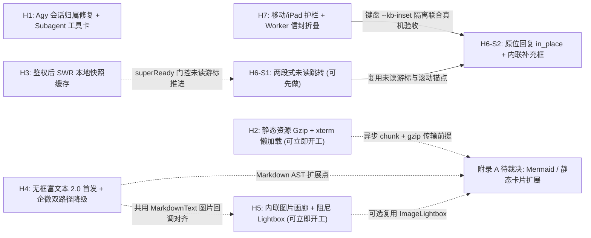

# Corgi 吸收 Collie（v0.3.11 → v0.3.16）高/中价值功能落地方案（评审修订版）

> **文档状态**：v2 评审修订稿（已依据 Codex 独立评审报告 `codex-4348` 逐项落实 A 档 P0/P1 修订并剔除 B 档理论加固项；Mermaid 方案 A/B 取舍与 B 档加固项单列附录 A 待用户裁决）  
> **设计基线**：原稿基于 Corgi `v0.1.79`（`12bb303` / `corgi/agy-4326 @ ec4d4d1`），本次修订核对至当前 `main` `v0.1.80`（`201e609`） ← 参考源 Collie `v0.3.16`（`3d10cba`）  
> **适用架构**：Go 1.25 单二进制（进程内 API 大脑 + SQLite WAL + yamux 多机机群）+ React 19 / TypeScript strict / Tailwind v4（极冷峻黑白纸面风）  
> **部署形态**：Linux CVM Hub（无订阅、公网 3–8 Mbps 小水管）+ Mac Node（运行 `claude`/`codex`/`agy`/`codebuddy` PTY Workers）+ 企业微信单聊（Smart Bot WSS）+ Web / iOS / iPad PWA  
> **约束红线**：严格遵守仓库 [AGENTS.md](../AGENTS.md) 单向依赖、零包级可变全局状态、锁内零 IO、Go 单文件 ≤400 行、React 单组件 ≤200 行、颜色唯一归属 `tokens.css` 等红线。

---

## 一、总览矩阵与核心收益

| 编号 | 价值 / 开工状态 | 功能主题 | 触达层 | 预估工作量（修订） | 关键量化/体验收益 | 实施批次 |
|---|---|---|---|---|---|---|
| **H1** | 高（P0 · 按修订归属契约开工） | Antigravity Subagent 双层防串话隔离 + 结构化 `SubagentCall` 渲染（定位与工具卡分提交） | Go（`model` / `runtime/agent` / `channel/web` / `core`）+ TS | **2.0–3.0 人日**（含跨机归属回归与真实样本联调） | 统一 Node 侧 `agy` 会话归属与历史写入门槛，根治同目录 Worker 串话污染企微直聊、`/last` 回合判断与历史恢复；`Subagent` / `Detail` 结构化可读 | Batch 1 |
| **H2** | 高（P0 · **可立即开工**） | 静态资源按需 Gzip 缓存 + 独立 `-gz` ETag + `xterm` 懒加载 | Go（`channel/web`）+ TS/Vite | **0.75–1.25 人日**（含 HTTP 表示协商与升级兼容测试） | 已有构建产物 JS+CSS 实测 `895,486 B` → gzip-9 `242,402 B`（**-73%**）；拆出 `xterm` 后首屏传输目标 **~154 KB（-82%，待实测签收）**；`/assets/*` `immutable` 缓存 | Batch 1 |
| **H3** | 高（P0 · 按鉴权后快照方案开工） | 鉴权后 SWR 快照缓存（适配 HttpOnly Cookie，杜绝鉴权前展示正文） | Go（`channel/web` 极小）+ TS | **1.0–1.5 人日**（含身份切换/401/分帧对账验收） | 首帧无敏感骨架零白屏，`/api/session` 通过且 `scope` 匹配后瞬时填充正文，避免等待 SSE 首帧空白；401/撤销配对零正文闪现 | Batch 1 |
| **H4** | 中（P1 · 首发聚焦基础富文本 + 企微双路径降级） | 极冷峻无框富文本 2.0（代码/diff、无框表、Callout、`<details>`、KPI/Steps、`HtmlPreviewPane` 主题联动 + 企微双出站路径降级） | Go（`core` 提示词 + `channel` 企微双路径降级）+ TS/CSS | **2.0–3.0 人日**（首发基础富文本 + 企微双路径联调；Mermaid 等见附录 A） | 消除硬外框与移动端表格横滚；长回复结构化密度大幅提升；企微大脑正文与 Worker 直聊双路径同步优雅降级零噪声 | Batch 2 |
| **H5** | 中（P1 · **可立即开工**） | 内联 `--file` 图片画廊 + 边界阻尼 Lightbox | 纯前端 TS/CSS（零后端改动，复用现成 Artifact/File API） | **1.0–1.5 人日**（含远端失败回落与手势/焦点验收） | 交付截图直接内联画廊（1–4+ 格，保留 Worker 报告卡与失败降级 chip）；手势灯箱首尾 `0.25×` 阻尼不回绕 | Batch 2 |
| **H6** | 中（P1 · 两段未读可先做；原位回复按约定接入） | 两段式未读跳转 + 早先消息原位回复（`in_place`）+ 内联补充框防失焦 | Go（`model` / `core` / `channel/web`）+ TS | **2.0–3.0 人日**（含队列/Action 透传与视口锚点联调） | 先跳第一条未读再回底；向上翻历史原位补充保持阅读锚点稳定、覆盖排队/插队/拍板全链路与旧版回滚边界 | Batch 3 |
| **H7** | 中（P1 · **真机实测签收**） | 移动/iPad 工程护栏（`@property --kb-inset` 键盘隔离、发送保焦、iPad GPU 覆盖侧栏、Worker 信封折叠） | 纯前端 TS/CSS | **1.25–2.0 人日**（含 iPhone/iPad 真机迭代签收） | 缓解 iPad/iOS 软键盘收起白闪与发送闪收键盘；iPad `768–1023px` 覆盖侧栏不挤压正文；Worker 任务信封折叠且保留 Trigger ID/完整任务入口 | Batch 3 |

> **总预估工作量（首发主方案，按 Codex A 档最低交付范围重估）**：**10.0 – 15.25 人日（约 10–15 人日，含必要测试与一轮跨机/真机联调）**。  
> - 若后续用户裁决追加附录 A 中的 Mermaid 离线图与静态卡片扩展，另计 **+2.0–3.0 人日**。  
> - 按 3 个增量批次多 Worker 并行开发 + 串行联调/发版验证排期，预计日历周期约 **6–9 个工作日**（原稿 3–4 天未计入跨机回归、双出站联调与真机签收）。其中 **H2、H5 当前即可立即开工**。

---

## 二、逐项详细落地方案（H1 – H7）

---

### H1. Antigravity Subagent 双层防串话隔离 + 结构化 `SubagentCall` 渲染

> **开工状态**：需按本节修订后的 Node 会话归属判定、历史写入条件、Node 本地清理与旧 reader 释放契约落地；**定位修复与工具卡片拆为独立提交与验收**。

#### 1. 目标与 Collie 参考基线
- **核心痛点**：Antigravity (`agy`) 在执行 `invoke_subagent` / `swarm` 时会在同一 `cwd` 派生子会话，且 `herdr` 不总是上报 `agy` 的 `session_id`。当前模糊匹配直接按 `cwd` + `transcript.jsonl` **文件** `mtime` 倒序取首项，会产生三类后果：(a) 把子 Agent 会话日志错绑到父 Worker 窗格造成串话；(b) 同目录并发兄弟 Worker 互相抢占对方 transcript；(c) **影响面远超 Web**——Mac Node 本地承载 `/chat`、`/last`、`/earlier`、`/titles`，其中 `/chat` 给**企微 Worker 直聊进度流**供数、`/last` 给 **Hub 回合判断与工具统计**供数、`/titles` 推断出的会话 ID 还会经 `StopWorker` 持久化进 Worker 与历史恢复表（`EndedSession`），错误猜测一旦落盘就会污染后续 `agy --conversation <id>` 恢复！同时注意：Collie 遇到的 Linux artifact 写入刷新**目录** `mtime` 是移植目录级逻辑时需防的另一类触发条件（不同于当前文件 `mtime` 触发），采用首行不可变 `created_at` 可同时免疫两者。此外，当前工具调用参数直接按原始 JSON 截断，嵌套转义参数难以阅读。
- **Collie 参考基线**：`collie` `v0.3.11` — `internal/collie/agy.go#L47-L138`（`agyTranscriptMeta`、`agySummaryColumns`、`agyTopLevelWhere`）、`agy.go#L242-L414`（`agyWorkspaces`、`guessAgy`、`normPath`、`fileURIToPath`）；`internal/collie/chat.go#L20-L35, #L426-L710`（`SubagentCall`、`formatToolDetail`、`buildToolMessage`）。

#### 2. Corgi 现状代码定位（核对至 `v0.1.80`）
- **[internal/runtime/agent/agy.go](../internal/runtime/agent/agy.go)**：
  - `ResumeArgs`（`L58-L63`）：已有确定性恢复参数 `--conversation <sessionID>`；
  - `LocateTranscript`（`L292-L334`）：已有 `sessionID != ""` 的显式 ID 路径，但无显式 ID 时未做 `filepath.EvalSymlinks` 规范化、未读首行 `created_at` 与 `SYSTEM_MESSAGE` 标记、未做 Worker 身份校验、未做跨 pane 互斥占用（`claimed`），直接按 `os.Stat(f).ModTime()`（文件 `mtime`）倒序硬取 `cands[0]`；
  - `agyWorkspaces`（`L670-L697`）：直接执行 `SELECT conversation_id, workspace_uris FROM conversation_summaries WHERE last_modified_time > ?`，未探测列结构，未过滤 `nesting_depth / killed / parent_conversation_id / agent_name`，且对 `file://` 未做 `url.PathUnescape`；
  - `ParseTranscriptLine`（`L348-L441`）与 `summarizeAgyToolArgs`（`L452-L462`）：仅尝试 4 个键（`CommandLine/Path/query/toolSummary`），未解码双层 JSON 字符串，未提取 `SubagentCall` 与折叠 `Detail`。
- **[internal/runtime/agent/adapter.go](../internal/runtime/agent/adapter.go)**：
  - `Adapter` 接口（`L62-L73`）：`LocateTranscript(home, cwd, sessionID string, since time.Time) string`，缺乏 `paneID`、`workerName` 与归属确认语义。
- **全部 `LocateTranscript` 调用点（实测共 6 组、7 处）**：
  1. [internal/channel/web/handlers_panes.go:628](../internal/channel/web/handlers_panes.go#L628)（`readerForPane`，服务 `/last` 与 `/earlier`）
  2. [internal/channel/web/handlers_panes.go:676](../internal/channel/web/handlers_panes.go#L676)（`handleStreamChat`，服务 `/chat` SSE；注意此处 `if p := ...; p != "" && p != lastPath` 在 `p == ""` 时**不会释放旧 `reader`**）
  3. [internal/channel/web/handlers_titles.go:95](../internal/channel/web/handlers_titles.go#L95)（`localPaneSessions`，服务 `/titles`）
  4. [internal/channel/web/handlers_titles.go:320](../internal/channel/web/handlers_titles.go#L320)（`handleGetTranscript`，已带显式 `session`）
  5. [internal/core/direct_relay.go:490](../internal/core/direct_relay.go#L490)（本地 Hub Worker 直聊）
  6. [internal/core/summary_trust.go:171](../internal/core/summary_trust.go#L171) & [L238](../internal/core/summary_trust.go#L238)（共 2 处，本地 Hub Worker 摘要/工具统计）
- **关键下游消费点与生命周期约束**：
  - [internal/channel/wecom_stream.go:598-617](../internal/channel/wecom_stream.go#L598-L617)：企微 Worker 直聊进度流直接消费 Node `/api/panes/{id}/chat`；
  - [internal/core/workers.go:1268-1318](../internal/core/workers.go#L1268-L1318)：`StopWorker` 在 `wk.Session == ""` 时经 `lookupRemoteSession` 查远端 `/titles` 并写入 `wk.Session` 与 `EndedSession` 恢复历史；
  - [internal/channel/web/handlers_titles.go:191-194](../internal/channel/web/handlers_titles.go#L191-L194) & [cmd/corgi/main.go:238-248](../cmd/corgi/main.go#L238-L248)：`WatchEndings` 开头判断 `if s.Store == nil || s.Fleet == nil { return }`，而 Mac Node 启动的 `nodeSrv` 无 `Store`（`NodeOnly: true`），**Node 根本跑不到 `WatchEndings`**！
- **[internal/model/runtime.go:166-175](../internal/model/runtime.go#L166-L175)** & **[web/src/types/api.ts:467-475](../web/src/types/api.ts#L467-L475)**：`Message` / `ChatMessage` 当前无 `Detail` 和 `Subagent` 字段。
- **[web/src/features/agents/AgentChatThread.tsx:121-135](../web/src/features/agents/AgentChatThread.tsx#L121-L135)**：仅渲染通用 `<details>` 工具行，无 Subagent 卡片与结构化 `detail` 展示。

#### 3. 落地改动点（拆分为「提交 1：Node 会话归属修复」与「提交 2：Agy 结构化工具卡」）

##### 提交 1 · 后端（Go）：Node 会话归属判定、历史写入门槛、本地清理与旧 reader 释放
> **红线守卫**：严禁照搬 Collie 的包级全局变量 `agyIndex` / `agyPaneSessions` / `claimed`；状态一律挂在各机（Hub / 每个 Mac Node）各自的 **`AgyAdapter` 结构体实例**上（由 `agent.NewRegistry()` 创建），**候选文件/SQLite IO 一律在锁外完成，认领复核与提交在锁内原子执行**，保证并发测试 `t.Parallel()` 100% 隔离。

1. **带归属证据的可选定位接口 — `internal/runtime/agent/adapter.go`（零破坏扩展）**：
   - 保留现有 `LocateTranscript(home, cwd, sessionID string, since time.Time) string` 签名，同时新增扩展接口与结果结构：
     ```go
     type LocateHint struct {
         PaneID     string // 归一化本地 paneID，用于本机 claimed 互斥归属
         WorkerName string // Corgi worker 名或 herdr agent name，用于首行身份辅助校验
         SinceKnown bool   // startedAt 是否已知（重启后未知时禁止仅凭时间硬猜）
     }
     type LocateResult struct {
         Path      string // 定位到的 transcript 路径；无法确认归属时必须为 ""
         SessionID string // 对应的会话 ID（仅在 Verified == true 时可对外持久化）
         Verified  bool   // true：来自显式 ID 或双层过滤唯一确认并原子认领；false：不可用于写入恢复历史
     }
     type ContextTranscriptLocator interface {
         LocateTranscriptWithHint(home, cwd, sessionID string, since time.Time, hint LocateHint) LocateResult
         ReleasePane(paneID string)
         ReconcileLivePanes(livePaneIDs map[string]bool)
     }
     ```
   - 新增辅助函数 `LocateTranscript(ad Adapter, home, cwd, sessionID string, since time.Time, hint LocateHint) LocateResult`：若 `ad` 实现 `ContextTranscriptLocator` 则走防串话归属路径，否则包装旧 `ad.LocateTranscript(...)`（仅当入参 `sessionID != ""` 时置 `Verified = true`）。上述 6 组共 7 处调用点全部切换至该辅助函数并透传 `PaneID` / `WorkerName` / `SinceKnown`。

2. **三步确定性归属判定 — 拆分新文件 `internal/runtime/agent/agy_locate.go`（控制单文件 ≤350 行）**：
   - 实例级状态挂在 `AgyAdapter`：`indexMu`（3s TTL 缓存 `indexWS`，读库在锁外完成再交换写回）、`claimMu`（`claimed map[string]paneClaim` + `paneOwner map[string]string`，记录 `paneID` + `startedAt` 代次）。
   - **Step 1（第一优先：复用已有显式会话 ID）**：若入参 `sessionID != ""`（来自启动/恢复 `--conversation` 或 `herdr` 上报），直接按显式 ID 定位，找到后在锁内原子写入本 pane 的 `claimed`（若 `hint.PaneID != ""`），返回 `LocateResult{Path: p, SessionID: sessionID, Verified: true}`；若显式 ID 对应文件暂未生成，直接返回空（**绝不降级去猜别人的会话**）。
   - **Step 2（无显式 ID 时：两层过滤缩小候选）**：
     - 若本 `paneID`（同 `startedAt` 代次）已有存活 claim 且文件仍在，复核后直接复用；
     - **第 1 层（SQLite 动态 Schema 过滤）**：`agySummaryColumns(db)` 经 `PRAGMA table_info(conversation_summaries)` 探测列；`agyTopLevelWhere(cols)` 动态过滤 `COALESCE(nesting_depth,0)=0`、`COALESCE(killed,0)=0`、`COALESCE(parent_conversation_id,'')=''`、`COALESCE(agent_name,'')=''`；用 `fileURIToPath`（含 `url.PathUnescape`）+ `normPath`（`filepath.Clean` + `filepath.EvalSymlinks`）解决 macOS `/var`→`/private/var` 与符号链接失配；
     - **第 2 层（Transcript 首行不可变元信息）**：`agyTranscriptMeta(path)` 仅读 `transcript.jsonl` 首行（64 KiB reader）：
       1. 提取 `created_at`（`time.RFC3339Nano`）作为不可变诞生时间 `born`，免疫文件与目录 `mtime` 漂移；
       2. 若 `type == "SYSTEM_MESSAGE"` 或 `(source == "SYSTEM" && type != "" && type != "USER_INPUT")` → 判定子会话直接剔除；
       3. 解析首行 Corgi 派发信封 `[corgi task · worker=([a-z][a-z0-9_-]{0,31})\b` 作为身份辅助证据：当 `hint.WorkerName != ""` 且 `meta.workerName != ""` 且不相等时剔除；相等时标为 `exact` 匹配；
       4. 剔除已被其他存活 pane 占用的 `claimed` 路径。
   - **Step 3（严格收敛：无法唯一判断归属时返回“无结构化记录”）**：
     - 仅当满足以下任一确定条件时，在 `claimMu` 锁内二次复核未被抢占后原子提交 `claimed[canonicalPath]`（key 统一为 `transcript.jsonl` 规范路径，返回时再 `preferFullTranscript` 升格）并返回 `Verified: true`：
       1. 过滤后存在唯一的 `exact`（Worker 名精确命中）候选；
       2. 无 `exact` 时，过滤并排除其他已认领路径后**仅剩唯一 1 个**落在本次启动窗口内的候选（`SinceKnown == true` 且 `born >= since - 10s`）。
     - **若仍存在多个无法区分的候选、或无候选满足归属条件**：**直接返回空 `LocateResult{}`（即无结构化记录），严禁按 `mtime` 随便猜 `cands[0]`！**
     - 上游清晰降级：Web `/chat` 自动退回展示该 pane 自身的终端 `log`；Hub `/last` 回合统计与企微直聊流明确表现为“结构化记录不可用”，不混入他人日志。

3. **明确历史写入条件（杜绝猜测会话污染恢复记录）**：
   - `handlers_titles.go:95` `localPaneSessions`：仅当 `res.Verified && res.SessionID != ""` 时填充 `PaneSession.Session`；未确认归属时置空 `Session`（仅保留 `Title` / `Run`）。
   - 由此联动保护下游 `StopWorker`（`internal/core/workers.go:1268-1318`）与 Hub `WatchEndings`（`handlers_titles.go:224`）：**只有已确认归属的会话 ID 才会写入 Worker 持久化记录与 `EndedSession` 恢复历史**，彻底阻断“猜错一次、下次恢复永久串话”的链路。

4. **明确 Node 本地清理职责（替代不可达的 `WatchEndings`）**：
   - 明确删除原案“依赖 `WatchEndings` 清理 Node claim”的设计——`WatchEndings` 依赖 `Store` 仅在 Hub 运行，Mac Node 的 `nodeSrv` 永远不会执行它。
   - 改为**本机自管生命周期**：
     1. 本机 `handleCloseWorkspace`（Node 与 Hub 本地均会收到关窗请求）关闭工作区时立即调用 `ad.ReleasePane(localPaneID)`；
     2. 在本机（Node/Hub）**成功**获取到最新存活 `agents`/`panes` 列表时（例如 `localPaneSessions`、或 `readerForPane`/`handleStreamChat` 成功拉取 `s.Fleet.Agents(ctx)` 后，且仅在 `err == nil` 时执行），调用 `ad.ReconcileLivePanes(liveSet)` 自动清理已退出 pane 的 claim；
     3. 结合 `startedAt` 代次：同一 `paneID` 若 `startedAt` 变化，视为新会话代次，先释放旧 claim 再重新归属。

5. **定位返回空时立即释放旧 `reader` — `internal/channel/web/handlers_panes.go:676`**：
   - 修改 `handleStreamChat` 轮询逻辑：
     - 当 `res.Path != "" && res.Path != lastPath`：按原逻辑切换新 `reader` 并发送 `reset`；
     - **新增清空分支**：当 `res.Path == "" && reader != nil`（例如会话失去归属、无法唯一确认或 transcript 失效）时，显式执行 `reader = nil; lastPath = ""; ms = agent.MsgSync{}; lastLog = ""` 并发送 `sse.send("reset", []byte("{}"))`，让后续循环立即回落至 `L703` 本 pane 原始终端 `log` 渲染，杜绝继续输出旧 transcript！

##### 提交 2 · 后端 + 前端：Agy 结构化 `SubagentCall` 与 `Detail` 渲染
1. **契约先行 — `internal/model/runtime.go:166` & `web/src/types/api.ts:467`**：
   ```go
   type SubagentCall struct {
       Type   string `json:"type,omitempty"`   // research | self | swarm | Explore ...
       Role   string `json:"role,omitempty"`   // e.g. "Codebase Researcher"
       Prompt string `json:"prompt,omitempty"` // 截断至 maxDetail (4096)
       Model  string `json:"model,omitempty"`  // 非 "inherit" 时展示
   }
   // model.Message 增量新增可选字段（完全向前/向后兼容）：
   // Detail   string        `json:"detail,omitempty"`
   // Subagent *SubagentCall `json:"subagent,omitempty"`
   ```
   前端 `ChatMessage` 同步新增 `detail?: string` 与 `subagent?: { type?: string; role?: string; prompt?: string; model?: string }`。
2. **Agy 结构化工具格式化 — 新增 `internal/runtime/agent/tool_format.go`（≤220 行）**：
   - `parseToolArgs(raw json.RawMessage)` 解开 Antigravity 双层 JSON 字符串编码；
   - `buildAgyToolMessage(name string, raw json.RawMessage) *model.Message`：识别 `invoke_subagent` / `swarm(action=="add")` 填充 `Subagent` + 单行 `Input`；专项美化 `update_steps`、`send_message`、`manage_subagents`、`manage_task`、`schedule`、`ask_question`、`search_web`；其余工具经 `formatToolDetail` 输出可读键值块。
   - **范围聚焦**：本提交先在 `agy.go:388-394` 落地并验证（**严格保留现有 `Output` 与 `Error` 展示语义**）；是否将通用格式化器推广至 Claude/Codex 不混入本提交，留待附录 A 按需裁决。
3. **结构化渲染 — 拆独立小组件 `web/src/features/agents/ToolMessageItem.tsx`（≤130 行）**：
   - 由 `AgentChatThread.tsx:121-135` 调用：有 `m.subagent` 时渲染极冷峻无框微卡（`Subagent` 标签 + `role` + `type`/`model` 胶囊 + 单行 `input`，展开显示完整 `prompt`）；普通 `tool` 优先展示 `m.detail` 并保留 `m.output` 与 `m.error`（`var(--attn)` 提示点）。

#### 4. 单元测试与联调验收清单
- `internal/runtime/agent/agy_locate_test.go`（表驱动，`t.Parallel()`）：
  - 显式 `sessionID` 优先命中且不降级猜测；显式 ID 文件未落盘时返回空；
  - SQLite 老/新 Schema 过滤 `nesting_depth > 0` / `killed = 1` / `agent_name != ''`；首行 `SYSTEM_MESSAGE` 剔除；
  - 同 `cwd` 并发双 Worker 无显式 ID：有 `[corgi task · worker=...]` 时精确隔离且互不抢占；**无法区分多个候选时返回空（`Verified=false`）绝不硬猜**；
  - `ReconcileLivePanes` 与 `ReleasePane` 正确回收退出 pane claim；
  - `handleStreamChat` 在定位从有效路径变为 `""` 时释放旧 `reader` 并发送 `reset` 回退 `log`；
  - `localPaneSessions` 在 `Verified=false` 时不输出 `Session`（阻断写入历史）；
  - `buildAgyToolMessage` 双层 JSON 解码与 `invoke_subagent`/`swarm`/`update_steps` 解析。
- **跨机联调验收**：在真实 Mac Node 上用同一组 `agy` 会话样本（同目录双 Worker 无 ID、子会话先出现、Node 重启、旧会话 `--conversation` 恢复）对齐验证 Web `/chat`、企微直聊进度流与 Hub `/last` 回合证据。
- `web/tests/agent-tool-render.test.mjs`：断言 `SubagentCall` 卡片、`detail` 与原有 `output`/`error` 正常渲染。

#### 5. 预估工作量
- 提交 1（Node 会话归属判定 + 历史写入条件 + 本地清理 + 旧 `reader` 释放 + 跨机回归样本）：**1.5–2.25 人日**
- 提交 2（Agy `SubagentCall` / `Detail` 解析与前端微卡 + 单测）：**0.5–0.75 人日**
- **合计**：**2.0–3.0 人日**

#### 6. 风险点与回退方式
- **风险 1**：只升级 Hub 而未升级运行 `agy` 的 Mac Node，或离线 Node 漏升，会导致该机仍走旧模糊定位。
  - *缓解*：Corgi 机群更新严格按 **在线 Node 先、Hub 后**执行（[internal/channel/web/update_fleet.go:261](../internal/channel/web/update_fleet.go#L261)）；发布时逐台核验运行 `agy` 的 Node 版本号，离线 Node 上线后补升再验收。
- **风险 2**：Antigravity CLI 未来改动 `conversation_summaries.db` 列名或首行字段。
  - *缓解*：`agySummaryColumns` 动态探测列，缺列跳过对应过滤子句；首行无法解析且多候选并存时宁可返回无结构化记录也不错绑。
- **回退方式**：定位与工具卡独立提交；`Subagent`/`Detail` 均为 `omitempty` 可选字段；若定位异常可单提交回退至保守模式或用上一标签各平台二进制回滚（回退后人工核查期间落盘的 `EndedSession`）。

---

### H2. 静态资源按需 Gzip 缓存 + 独立 `-gz` ETag + `xterm` 懒加载

> **开工状态**：**可立即开工（Batch 1 首发）**。架构落点与收益路径均已核实。

#### 1. 目标与 Collie 参考基线
- **核心痛点**：经对当前 `v0.1.79`/`v0.1.80` 已有构建产物字节复算，首屏 `web/dist/assets/index-*.js` + `index-*.css` 合计 **895,486 B（约 875 KiB）**，当前 `server.go:575-610` 未压缩传输且对带哈希资源也返回 `Cache-Control: no-cache`。仅启用 gzip-9 即可实测压至 **242,402 B（约降 73%）**；叠加 `@xterm/xterm` 按需拆包懒加载后，首屏传输目标可进一步降至 **~154 KB（-82%，以拆包构建与 CVM 实测结果签收）**。
- **Collie 参考基线**：`collie` `v0.3.12` — `internal/collie/server.go#L1058-L1193`（`staticAsset`、`isCompressibleStatic`、`acceptsGzip`、`static()`）；`web/app.js#L17572-L17635`（`ensureXterm` 懒加载）。

#### 2. Corgi 现状代码定位（核对至 `v0.1.80`）
- **[internal/channel/web/server.go](../internal/channel/web/server.go)**：
  - `Server.etags`（`L53`）：当前仅存 `string` 单态 ETag；
  - `staticHandler()`（`L575-L596`）与 `fileETag()`（`L598-L610`）：外层快速路径用 `==` 比较 ETag（不命中时后续 `http.FileServerFS` 仍处理标准条件请求），但完全无 Gzip 表示、无 `Vary: Accept-Encoding`、`/assets/*` 带哈希资源也返回 `no-cache`，且缺失 `/assets/*` 会错误回退到 `index.html`。
- **[web/src/components/TerminalScreen.tsx:1-4](../web/src/components/TerminalScreen.tsx#L1-L4)** & **[web/src/features/agents/AgentPaneView.tsx:5, 542](../web/src/features/agents/AgentPaneView.tsx#L5)**：顶层静态导入 `TerminalScreen`，将 `@xterm/xterm` 及其 CSS 打入首屏主 bundle。

#### 3. 落地改动点

##### 后端（Go）
1. **静态表示选择 + 复用 `http.ServeContent` — 新增 `internal/channel/web/static.go`（≤140 行）**：
   - 将 `Server.etags` 升级为实例级 `staticAssets sync.Map`（零包级全局状态），按需在首次命中某可压缩静态资源时以 `gzip.BestCompression` 压缩并缓存其 `raw` / `gz` 字节与对应强 ETag（`"<16hex>"` 与 `"<16hex>-gz"`，仅当 `len(gz) < len(raw)` 时启用压缩态）：
     ```go
     type staticAsset struct {
         raw          []byte
         gz           []byte
         etag         string
         gzETag       string
         contentType  string
         compressible bool
         immutable    bool // 仅确认带 Vite 内容哈希的 assets/* 为 true
     }
     ```
   - **优先复用 Go 标准库 HTTP 语义**：
     - 对可压缩资源（`.html`/`.js`/`.mjs`/`.css`/`.svg`/`.webmanifest`/`.json`），无论最终返回 `identity` 还是 `gzip`，一律写 `Vary: Accept-Encoding`；
     - `acceptsGzip(r)` 正确解析 `q` 权重（识别 `gzip;q=0` 拒绝）；若请求携带 `Range` 头，回退选 `identity` 表示以完整支持 `206 Partial Content`；
     - 选定目标表示（`body` + 对应 `etag` + 必要时 `Content-Encoding: gzip`）后，直接调用 `http.ServeContent(w, r, name, time.Time{}, bytes.NewReader(body))`，复用标准库对多值/弱 `If-None-Match`、`HEAD`、`Range`、`If-Range` 的完整 RFC 9110 处理！
   - **缓存分级与真 `404` 保护（D2）**：
     - 已确认带内容哈希的 `assets/*`：`Cache-Control: public, max-age=31536000, immutable`；**缺失的 `/assets/*` 文件必须返回真 `404`，严禁 SPA fallback 到 `index.html`**！
     - `index.html`、`manifest.webmanifest`、`icon.svg` 及 SPA 路由回退页：保持 `Cache-Control: no-cache`（确保新版本发布后零延迟重新验证）。
   - **流式/文件接口隔离**：仅作用于 `staticHandler()`；SSE (`/api/events`, `/api/panes/*/stream`, `/api/panes/*/chat`) 与 `/api/file`、`/api/artifacts/*/raw` 保持原独立路由，不套 gzip 中间件。

##### 前端（React / Vite）
1. **`AgentPaneView.tsx` 懒加载 `TerminalScreen`**：
   ```tsx
   const LazyTerminalScreen = lazy(() =>
     import("../../components/TerminalScreen").then((m) => ({ default: m.TerminalScreen }))
   );
   ```
   - 仅当 `mode === "screen"` 时挂载 `<Suspense>`，由 Vite 自动将 `@xterm/xterm`、`@xterm/addon-fit`、`xterm.css` 拆入独立异步 chunk；
   - 外包轻 `ErrorBoundary`，捕获升级后旧页面请求失效 chunk 或网络加载失败时展示「控制台已更新或加载失败，点击刷新」恢复按钮。

#### 4. 单元测试与验收清单
- `internal/channel/web/static_test.go`：
  - `Accept-Encoding: gzip` 返回 `Content-Encoding: gzip`、`Vary: Accept-Encoding`、`-gz` ETag 且解压逐字节一致；
  - `gzip;q=0` 或无头返回原文与非 `-gz` ETag（仍带 `Vary`）；
  - `If-None-Match` 同表示返回 `304`，跨表示（拿原文 ETag 请求 gzip）返回 `200`；
  - `HEAD`、`Range` 请求行为符合 RFC 9110；
  - `/assets/index-abc.js` 返回 `immutable`，缺失 `/assets/nonexistent.js` 返回真 `404`（非 HTML），`/` 与 SPA 路由返回 `no-cache`。
- **构建与 CVM 实测验收**：核验 `web/dist/assets/` 生成独立 `TerminalScreen-*.js` chunk 且主 `index-*.js` 不含 `xterm`；在同一 CVM 入口实测冷开、暖开、首次打开终端三场景的真实传输字节（目标首屏 ≤ ~154–170 KB gzip-9）及升级后旧页面点击「屏幕」的刷新恢复路径。

#### 5. 预估工作量
- Go：`static.go` + HTTP 表示/协商/升级边界单测：**0.5–0.75 人日**
- 前端：`AgentPaneView.tsx` 懒加载 + `ErrorBoundary` + 产物/CVM 验收：**0.25–0.5 人日**
- **合计**：**0.75–1.25 人日**

#### 6. 风险点与回退方式
- **风险 1**：升级后旧页面未刷新直接点「屏幕」请求已下线的旧哈希 `TerminalScreen-<old>.js`。
  - *缓解*：后端 `/assets/*` 缺失返真 `404` + 前端 `ErrorBoundary` 一键刷新恢复。
- **回退方式**：后端切回旧 `staticHandler()`、前端改回静态 `import`，零数据副作用。

---

### H3. 鉴权后 SWR 快照缓存（适配 HttpOnly Cookie，杜绝鉴权前展示）

> **开工状态**：已按 Codex P0 评审修订——**将正文快照读取与展示严格移至 `/api/session` 鉴权通过之后**，替代原案鉴权前展示方案。

#### 1. 目标与 Collie 参考基线
- **核心痛点**：Corgi [useCorgiStream.ts:13-98](../web/src/hooks/useCorgiStream.ts#L13-L98) 初始化时 `superView = null, paneState = null`，在 `/api/session` 之后还需等待 `/api/events` 建立 SSE 连接并推送首帧 `super` 和 `state`，弱网/公网 CVM 环境下经常出现 300ms–1.5s 空白期。同时必须守住安全底线：**在服务端未确认本次浏览器会话有效前，绝不把本地留存的上次聊天正文、Worker 路径或附件元数据展示出来**（否则配对撤销后重开页面仍会先闪现旧正文造成信息披露）。
- **Collie 参考基线**：`collie` `v0.3.13` — `web/cache.js#L1-L738`（200 KB UTF-8 预算裁剪、30 天 TTL、350ms 防抖写、401/登出清缓存）。

#### 2. Corgi 现状代码定位（核对至 `v0.1.80`）
- **[internal/channel/web/server.go:297-310](../internal/channel/web/server.go#L297-L310)**：`handleSession` 返回 `{"ok": true, "version": s.Version}`；采用 **HttpOnly Cookie (`corgi_token`)**，前端无法也绝不接触明文 token。
- **[internal/channel/web/server.go:521-548](../internal/channel/web/server.go#L521-L548)**：`handleStreamEvents` 分别发送独立的 `super` 与 `state` 两条 SSE 事件。
- **[web/src/App.tsx:44-80](../web/src/App.tsx#L44-L80)** & **[web/src/hooks/useCorgiStream.ts:13-98](../web/src/hooks/useCorgiStream.ts#L13-L98)**：当前 `authed === null` 等 `/api/session` 完成后才进入主界面，无本地 SWR 快照，且 `EventSource.onerror` 未触发会话复核。

#### 3. 落地改动点

##### 后端（Go — 极小增量，~15 行）
- **[internal/channel/web/server.go:305-310](../internal/channel/web/server.go#L305-L310)** `handleSession`：
  - 基于 `s.identity(r)` 与服务实例标识计算不可逆、非敏感的 12 位十六进制 `scope` 指纹（master 返回 `sha256("corgi-scope:master:" + instanceSalt)[:12]`；已配对浏览器设备返回 `sha256("corgi-scope:dev:" + instanceSalt + ":" + dev.ID)[:12]`，**严禁输入或输出明文 Token**）：
    ```json
    { "ok": true, "version": "v0.1.81", "scope": "a1b2c3d4e5f6" }
    ```
  - 向下兼容：若连接旧版服务端（响应无 `scope` 字段），前端自动跳过本地缓存读取，平滑回退直连 SSE。

##### 前端（React / TS）
1. **新增独立模块 `web/src/lib/snapshotCache.ts`（≤190 行）**：
   - **隔离键设计**：`corgi.snap.v1.<originKey>.<scope>.<threadKey>`（`originKey` 为 `window.location.origin` 轻量哈希，键内不含任何敏感信息）。
   - **字段白名单与体积预算**：
     - 仅按显式字段白名单持久化展示所需数据（`compactSuperView` + `compactPaneState`）：`entries` 最近 **45 条**（单条 `text` 软上限 24 KB UTF-8，按 `TextEncoder` 截断不拆断 UTF-16 代理对）、`actions` ≤ 40、`work_items` ≤ 30、`workers` ≤ 36、`agents` ≤ 50、`shells` ≤ 20、`pinned` ≤ 30；
     - **严禁落盘字段**：`share_token`、`settings`、任何凭据或私钥字段；
     - 总 UTF-8 硬上限 **200 KB**；`localStorage` 不可用（隐私模式）或超限时 `try/catch` 静默放弃不阻塞渲染；TTL **30 天**，超期或 `schemaVersion !== 1` 自动清除返回 `null`；
     - 写入采用 **350ms 防抖** + `visibilitychange(hidden)` / `pagehide` 末次 flush；
     - 导出 `clearAllSnapshotCaches()`：遍历删除所有 `corgi.snap.` 前缀键（绝不误删 `corgi.theme` 等设置键）。
2. **严格“先鉴权、后读缓存、分帧解锁写操作”启动时序 — `useCorgiStream.ts` & `App.tsx`**：
   - **阶段 1（`authed === null`，鉴权完成前）**：`App.tsx` 仅渲染**无任何敏感正文的极简应用壳骨架**（侧栏与主区极简线框占位），**严禁读取 `localStorage` 正文快照**。
   - **阶段 2（`/api/session` 返回后）**：
     - 返回 `401`：立即调用 `clearAllSnapshotCaches()`、清空内存状态并切至 `LoginView`；
     - 返回 `200` 且含非空 `scope`（且 URL 不含 `?pair=`）：**此时才同步按 `(originKey, scope, activeThread)` 读取匹配的本地快照**填充 `superView` 与 `paneState`，立即呈现在线可读界面（消除等待 SSE 握手与首帧传输的空白期），并标记 `superReady = false`、`stateReady = false`（展示极轻「同步中」状态点）。
   - **阶段 3（SSE 分帧对账与写操作门控）**：
     - 收到当前线程首帧 `super` 后置 `superReady = true` 并调度缓存写入；收到首帧 `state` 后置 `stateReady = true`；
     - **写操作门控**：依赖实时 `super` 状态的入口（如 `DecisionCard` 拍板按钮、快捷键与菜单操作）在 `superReady === false` 时保持禁用（防止鉴权刚过就点到企微已处理的旧卡片触发 `409`）；依赖 `state` 的机群/终端操作等 `stateReady === true` 后启用。
   - **会话失效与登出联动**：登出（`POST /api/logout`）、任意 `ApiError(401)`、或 SSE 异常重连时按需复核 `/api/session` 返回 `401`，一律立即清空内存态与 `clearAllSnapshotCaches()`。
3. **平滑对账零跳动**：
   - `useAutoScroll.ts` 在缓存态 → `superReady` 过渡时不改变 `resetKey`，保持吸底无跳动；若用户在缓存显示后已开始上滑看历史，首帧到达时不强拽回底。

#### 4. 单元测试与验收清单
- `web/tests/snapshot-cache.test.mjs`：
  - 正常读写、`schemaVersion` / 30 天 TTL 过期失效、不同 `scope` 隔离；
  - 超大 `SuperView` 压至 ≤200 KB UTF-8 且中文/Emoji 无乱码；
  - `share_token` / `settings` 不落盘断言；`clearAllSnapshotCaches` 不误删其他键。
- **鉴权与安全验收**：
  - 撤销浏览器配对后刷新/重开页面：确认 `LoginView` 出现前**绝对无旧正文闪现**，且旧快照被清；
  - 服务端缺 `scope`（模拟旧版 Hub）时安全回退直连；
  - 缓存命中态下拍板卡片按钮与键盘提交在 `superReady` 到达前不可触发；
  - **验收指标**（替换原案无条件 0ms 口径）：记录**「鉴权通过到首条可见消息耗时」**与**「缓存命中率」**。

#### 5. 预估工作量
- Go：`handleSession` 返回 `scope` + 单测：**0.25 人日**
- 前端：`snapshotCache.ts` + 鉴权后加载/分帧就绪门控/401 清理/无敏感骨架壳 + 单测：**0.75–1.25 人日**
- **合计**：**1.0–1.5 人日**

#### 6. 风险点与回退方式
- **风险 1**：`/api/session` 在极端弱网下耗时 100–250ms，首帧无法做到 0ms 出正文。
  - *权衡*：这是守住“配对撤销/身份失效绝不泄密”的必要安全边界；无敏感骨架壳已消除生硬白屏，鉴权通过后立即可读仍大幅快于等待完整 SSE 首帧。
- **回退方式**：关闭 `snapshotCache` 读取开关即可一键回到鉴权后直连 SSE，无任何数据副作用。

---

### H4. 极冷峻无框富文本渲染 2.0 + 企微双出站路径优雅降级

> **开工状态与首发边界（已按 Codex P0/D4/D5 修订）**：  
> - **Batch 2 首发范围**：基础无框富文本 2.0（代码/diff、无框表、Callout、白名单 `<details>`、`metrics`/`steps`、内联增强）+ `HtmlPreviewPane` 深浅色同步 + **企微双出站路径（大脑正文 + Worker 直聊）降级**；  
> - **脚本授权硬边界（D5）**：**反对在聊天消息内默认开放 `sandbox="allow-scripts"` + `script-src 'unsafe-inline'` 的 `html-card`**！交互式 HTML 继续唯一走现有 HTML Artifact 沙箱路径（`handlers_artifacts.go:13` HTTP 响应头 CSP）；  
> - **Mermaid 方案 A/B 取舍**：不写入本主方案默认范围，单列 **「附录 A：待用户裁决事项」**（默认按方案 B 先发基础富文本，零二进制膨胀）。

#### 1. 目标与 Collie 参考基线
- **核心痛点**：Corgi 当前 [MarkdownText.tsx](../web/src/components/MarkdownText.tsx)（354 行）仅支持基础 Markdown：代码块带厚重外框且无复制/折叠/diff 高亮；表格有硬边框且手机端易横滚；缺乏 Callout、折叠块、KPI/Steps 微块；[HtmlPreviewPane.tsx:160](../web/src/features/files/HtmlPreviewPane.tsx#L160) 硬编码 `colorScheme: "light"`。同时，企微单聊存在**两条独立正文出站路径**（大脑正文与 Worker 直聊），若不双路径同步降级，新富文本语法会直接裸露在企微消息中。
- **Collie 参考基线**：`collie` `v0.3.12–v0.3.16` — `web/app.js#L27550-L29500`、`internal/collie/cli.go#L912-L923`。

#### 2. Corgi 现状代码定位（核对至 `v0.1.80`）
- **[web/src/components/MarkdownText.tsx:207](../web/src/components/MarkdownText.tsx#L207)**（354 行）：被主聊天、Worker 对话、[DecisionCard.tsx:166](../web/src/components/DecisionCard.tsx#L166) 和文件预览共用；仅支持 3 反引号围栏与硬边框表格。
- **[web/src/features/files/HtmlPreviewPane.tsx:154-162](../web/src/features/files/HtmlPreviewPane.tsx#L154-L162)**：`<iframe sandbox="allow-scripts" style={{ colorScheme: "light" }} />`；与后端 [internal/channel/web/handlers_artifacts.go:17](../internal/channel/web/handlers_artifacts.go#L17) `artifactHTMLSandboxCSP` 配合承载已有交互 HTML 预览。
- **[web/src/styles/tokens.css](../web/src/styles/tokens.css)**（70 行）：尚未定义 Callout / Diff 低饱和语义变量及 [WorkNotebook.tsx:36](../web/src/features/chat/WorkNotebook.tsx#L36) 引用的 `--err`。
- **[internal/core/api_router_context.go:23-31](../internal/core/api_router_context.go#L23-L31)**：`apiRouterSystemPromptV1` 仅指引常规列表。
- **企微出站三处落点（双正文路径 + 卡片纯文本）**：
  1. **大脑最终正文**：[internal/channel/bus.go:699-704](../internal/channel/bus.go#L699-L704) `formatWeComReply`（覆盖流式封口、主动推送、卡片失败回落、outbox）；
  2. **Worker 直聊正文**：[internal/channel/wecom_focus.go:497-507](../internal/channel/wecom_focus.go#L497-L507) `formatDirectReplyBody`（由 `dispatchWeComDirectWorker` `onDone` 调用，独立于 `formatWeComReply`；超长回复在 `L523-L530` 另附原始 `.md` 文件）；
  3. **决策卡片标题/摘要**：[internal/channel/wecom/card_text.go:25](../internal/channel/wecom/card_text.go#L25) `stripMarkdownPlainText`。

#### 3. 落地改动点

##### 视觉红线对齐（`web/src/styles/tokens.css` 增量语义变量）
严格遵守 `AGENTS.md`「全站 99% 黑白暖灰 + 仅 1% 琥珀提醒点，禁止组件硬编码 hex、禁止高饱和 Tailwind 彩色类」：
- 在 `tokens.css`（light + dark 两套）新增极克制低饱和语义变量：
  - `--diff-add-fg` / `--diff-add-bg`（复用 `--ok` 低透明度混合）；
  - `--diff-del-fg` / `--diff-del-bg`（新增 `--danger: #b42318` / dark `#f87171`，同步别名 `--err: var(--danger)` 修复 `WorkNotebook.tsx:36`）；
  - `--co-note: var(--fg-2)`、`--co-tip: var(--ok)`、`--co-important: var(--fg)`、`--co-warning: var(--attn)`、`--co-caution: var(--danger)`（全部仅作用于 **2px 左竖线 + 标题图标**，不铺彩色大底）；
  - `--mark-bg`：极浅暖灰高亮（`==高亮==` 用）。

##### 前端模块化拆分（严守 React 单组件 ≤200 行红线，Batch 2 首发）
将 354 行的 `MarkdownText.tsx` 拆为 `web/src/components/markdown/` 目录（`MarkdownText.tsx` 保持薄导出入口及与 H5 约定的 `onOpenImage` 图片回调签名，保证所有调用方零破坏）：
1. **`markdown/parseBlocks.ts`（≤200 行，纯 TS 无 DOM）**：
   - CommonMark §4.5 多反引号 / 波浪线围栏（支持 4 反引号、`~~~` 嵌套代码块）；
   - 5 级无框 Callouts（`> [!NOTE|TIP|IMPORTANT|WARNING|CAUTION]`）与普通 `>` 块引用；
   - 白名单 `<details><summary>...</summary>...</details>`：仅解析结构标签，正文由 React 块级渲染器递归渲染（绝不走 `dangerouslySetInnerHTML`，天然 0 XSS）；
   - 结构化业务围栏：`metrics`（`Label | Value | Delta`）、`steps`（`[x]`/`[~]`/`[!]`/`[ ]`）、`diff`；遇到未启用的扩展围栏（如 `mermaid`/`html-card`）平滑降级为带复制按钮的普通代码块。
2. **`markdown/InlineText.tsx`（≤160 行）**：
   - 保留现有粗体/行内代码/文件芯片/外链/`[image:...]`，增量支持 `*斜体*`、`~~删除线~~`、`==软高亮==`、`<kbd>` 键帽、`path/file.go:123` 行号识别及 PR/Issue 单色紧凑胶囊。
3. **`markdown/CodeBlock.tsx`（≤160 行）**：
   - 无框画布融合（`var(--bg-2)` + 顶底 1px `var(--line)`）；外置右上语言标签与复制按钮（零 `backdrop-filter`）；默认软换行 + 一键切换横滚；`diff` 自动统计 `+N -M` 与极浅增删色带；超过 18 行默认柔和折叠 + `hidden="until-found"` 支持 `Cmd+F` 自动展开。
4. **`markdown/DataTable.tsx`（≤150 行）**：
   - 无框极简表；`data-cols` 自动分流（手机端 1–3 列 `table-layout: fixed` 自动折行零横滚；≥4 列横向滚动 + 首列 sticky + 边缘微弱渐隐）；纯数字列右对齐 + `tabular-nums`；TSV/Markdown 双模式复制；`ResizeObserver` 仅切遮罩态不改几何宽度。
5. **`markdown/RichBlocks.tsx`（≤170 行）**：
   - `CalloutBlock`（2px 左竖线）、`MetricsStrip`（响应式无框 KPI 条）、`StepsTimeline`（竖轨 + SVG 状态节点）、`TaskListItem`。
6. **`HtmlPreviewPane.tsx` 深浅色同步与脚本授权边界（D5）**：
   - 仅移除 `HtmlPreviewPane.tsx:160` 硬编码 `colorScheme: "light"`，使其随当前 `data-theme` 切换；
   - **脚本授权明确约定**：
     - 聊天消息流内**不开放**带 `sandbox="allow-scripts"` / `script-src 'unsafe-inline'` 的 `html-card` 自动执行脚本能力；
     - 复杂交互式 HTML 原型继续唯一通过现有独立 HTML Artifact 沙箱路径交付与预览（由后端 HTTP 响应头 [handlers_artifacts.go:17](../internal/channel/web/handlers_artifacts.go#L17) `artifactHTMLSandboxCSP` 强制约束，不与 `<meta>` CSP 混用，不扩大自动执行面）；
     - 静态无脚本 `html-card` 与 Mermaid 扩展不纳入首发，留待附录 A 裁决。

##### 后端（Go — 企微双出站路径降级 + 提示词受控开放）
1. **企微双出站路径共享降级器 — 新增 `internal/channel/wecom_markdown.go`（≤160 行）**：
   - 实现围栏感知的 `formatMarkdownForWeCom(text, publicURL string) string`（能识别多反引号/波浪线围栏边界，不误伤普通代码块内部文本）：
     - ```` ```metrics ```` → 紧凑 Markdown 列表（`- **首屏体积**：154 KB（-82%）`）；
     - ```` ```steps ```` → 图标清单（`✓` / `▶` / `⚠` / `○`）；
     - `> [!NOTE|TIP|IMPORTANT|WARNING|CAUTION]` → 企微原生引用块 `> **注意**：...`；
     - `<details><summary>标题</summary>正文</details>` → `**标题**\n正文`（超 300 字截断提示）；
     - 若模型或 Worker 仍输出 ```` ```mermaid ```` / ```` ```svg ```` / ```` ```html-card ```` → 折叠为单行可读摘要（如 `> 已生成图表/卡片，请在 Web 控制台查看`；若 [EffectivePublicURL()](../internal/core/artifacts.go#L164) 非空则附控制台链接，无公网地址时仅输出纯文字降级提示，不破坏现有附件投递与重试顺序）。
   - **必须同时接入两条企微正文出站路径**：
     - **路径 1（大脑出站）**：[internal/channel/bus.go:699](../internal/channel/bus.go#L699) `formatWeComReply(entry)` 调用 `formatMarkdownForWeCom(entry.Text, publicURL)`；
     - **路径 2（Worker 直聊出站）**：[internal/channel/wecom_focus.go:497](../internal/channel/wecom_focus.go#L497) `formatDirectReplyBody(...)` 在拼接标题/引用头、预览链接与执行 `directReplyMaxBytes` 字节裁剪**之前**，对 `fullText` 调用同一 `formatMarkdownForWeCom(fullText, previewURL)`；
     - **原始 Markdown 保留**：Web 展示与 Worker 直聊超长回复自动发送的 `.md` 文件附件（`wecom_focus.go:523-530`）继续使用未降级的原始 `res.FullText`。
   - **卡片纯文本同步**：[internal/channel/wecom/card_text.go:25](../internal/channel/wecom/card_text.go#L25) `stripMarkdownPlainText` 补齐对 `==高亮==`、`<kbd>`、`[!NOTE]` 等标记的剥离。
2. **大脑轻富文本指引受控开放 — `internal/core/api_router_context.go:23-31`**：
   - **上线顺序硬要求**：仅在 Web 基础渲染器与企微双出站路径降级**全部就绪后**，才在 `apiRouterSystemPromptV1` 末尾追加精简指引，且**仅开放首发已上线的语法**（Markdown 表格、Callout、`metrics`/`steps` 块；**不指引**尚未裁决上线的 `mermaid`/`html-card`）：
     > `8. 轻富文本表达：常规简短回复保持纯文本或列表；对比方案/进度汇报/关键指标可克制使用 Markdown 表格、Callout（> [!NOTE|WARNING]）及 metrics/steps 代码块；长文档或复杂交互原型继续由 Worker 产出独立文件交付。`

#### 4. 单元测试与验收清单
- `web/tests/markdown-render.test.mjs`：CommonMark 多反引号嵌套、diff `+N -M` 统计、18 行折叠、1–3 列 vs ≥4 列 `data-cols`、数字列右对齐、5 级 Callout、`<details>` XSS 注入拦截（`<script>`/`onerror` 纯文本化）、`metrics`/`steps` 渲染、与旧消息/普通代码块/文件引用及 `DecisionCard` 兼容性。
- `internal/channel/wecom_markdown_test.go`（表驱动）：覆盖**大脑正文（`formatWeComReply`）与 Worker 直聊正文（`formatDirectReplyBody`）双路径**、卡片纯文本（`stripMarkdownPlainText`）、有无 `EffectivePublicURL` 两种配置、围栏边界内不误转、原始 `.md` 附件未降级断言。

#### 5. 预估工作量
- 前端基础无框富文本 2.0（`markdown/` 拆分 + `tokens.css` + `HtmlPreviewPane` 主题联动 + 单测）：**1.25–2.0 人日**
- 后端企微双出站路径降级（`wecom_markdown.go` + `bus.go` + `wecom_focus.go` + `card_text.go` + 提示词 + 企微联调）：**0.75–1.0 人日**
- **合计（H4 首发）**：**2.0–3.0 人日**（若附录 A 后续裁决追加 Mermaid 与静态卡片，另加 2.0–3.0 人日）

#### 6. 风险点与回退方式
- **风险 1**：Web 回退 H4 但忘记撤回大脑提示词，导致大脑继续产出新围栏使旧渲染器裸露源码。
  - *缓解*：建立**启停同步纪律**——大脑提示词的新语法指引必须与 Web 渲染器及企微双路径降级同期启用、同期回退。
- **风险 2**：`<details>` 或自定义块破坏 `DecisionCard` 紧凑布局。
  - *缓解*：通过 `MarkdownText` 现有调用方回归验证主聊天、Worker 对话与决策卡三处样式；SQLite 始终保存原始 Markdown 文本，回退零数据损失。

---

### H5. 内联 `--file` 图片画廊 + 边界阻尼 Lightbox

> **开工状态**：**可立即开工（Batch 2 与 H4 并行，开工前先对齐共用 `MarkdownText` 的 `onOpenImage` 回调签名）**。后端零改动。

#### 1. 目标与 Collie 参考基线
- **核心痛点**：当前 [CorgiChatView.tsx:884-1142](../web/src/features/chat/CorgiChatView.tsx#L884-L1142) 把 `--file` 交付的图片渲染为普通文件卡，多图预览需逐张点开 `FileDrawer`；[FileDrawer.tsx:339-347](../web/src/features/files/FileDrawer.tsx#L339-L347) 的灯箱仅支持单图静态展示，无翻页/手势/焦点归还；[MarkdownText.tsx:141-158](../web/src/components/MarkdownText.tsx#L141-L158) 的 `[image:...]` 仅跳抽屉。
- **Collie 参考基线**：`collie` `v0.3.15–v0.3.16` — `web/app.js#L4242-L4415`、`web/app.js#L21077-L21270`。

#### 2. Corgi 现状代码定位（核对至 `v0.1.80`）
- **[web/src/features/chat/CorgiChatView.tsx:884-1142](../web/src/features/chat/CorgiChatView.tsx#L884-L1142)**：现有渲染严格遵循 **`entry.artifacts` 优先、整组缺失时才走 `entry.files`（`L1110`）**，且首个 artifact 还可能承载 Worker 报告入口——画廊必须保留这套归属与分支边界，**严禁把两组直接拼接**。
- **[web/src/features/files/FileDrawer.tsx:149, 339-347](../web/src/features/files/FileDrawer.tsx#L339-L347)**：已有图片预览 URL 规则与静态灯箱。
- **[web/src/components/MarkdownText.tsx:141-158](../web/src/components/MarkdownText.tsx#L141-L158)**：`[image:...]` 单图按钮。
- **后端现状（已完备，零后端改动）**：`/api/artifacts/{id}/raw`（`handlers_artifacts.go`）与 `/api/file?path=...&as=image&machine=...`（[handlers_files.go:251-264](../internal/channel/web/handlers_files.go#L251-L264)，单文件上限 20 MiB，支持远程 Node 转发 + `Cache-Control: private, max-age=3600`）均已现成。

#### 3. 落地改动点

##### 后端（Go）
- **零改动**。

##### 前端（React / TS / CSS）
1. **新增 `web/src/components/ImageGallery.tsx`（≤150 行）**：
   - 统一数据模型 `GalleryImageItem`（含 `id`、`dedupKey`、`src`、`downloadUrl?`、`name`、`size?`、`subtitle?`、`fallbackFile`）；
   - **确定性去重规则**：去重键一律使用可确定的 **`artifact.id`** 或 **`machine + 规范完整路径`**，严禁仅按文件名去重（避免不同目录下同名截图被误折叠）；
   - **布局规格（极冷峻无框融合）**：
     - 单图（1 张）：保留原始宽高比，最大高度 `380px`（桌面）/ `320px`（移动端），预设 `min-h-[140px]` 与 `var(--bg-2)` 骨架占位防加载前高度塌陷；
     - 2–4+ 张：2 列等高网格（`grid-cols-2 gap-1.5`），固定 `aspect-[4/3]` + `object-cover object-top`；超过 4 张时第 4 格叠加纯黑暗罩 `+N`，首屏最多并发请求 4 张原图（第 5 张起仅在打开 Lightbox 翻页时按需加载）；
     - **失败/过期/远端离线自动降级**：维护 `failedIds: Set<string>`，`` 立即原地退回现有文件卡片或下载入口；已过期的 artifact 继续保留现有过期卡片，绝不留破图图标。
2. **新增 `web/src/components/ImageLightbox.tsx`（≤195 行）**：
   - React Portal 挂载至 `document.body`，打开时记录触发元素，**关闭时归还焦点并还原滚动位置**；
   - **手势与边界阻尼**：舞台 `touch-action: none`，纯 GPU `translate3d(x, y, 0) scale(s)` 跟手横滑；首尾禁止循环回绕，越界施加 **`0.25×` 阻尼（硬限幅 `±48px`）**松手回弹；边界箭头 `disabled` 且 `stopPropagation()`；键盘 `ArrowLeft`/`ArrowRight` 到边即停、`Escape` 关闭、`+`/`-`/`0` 或双击缩放 `1× ↔ 2×`；底部纯黑半透明信息栏（**禁止 `backdrop-filter`**）含文件名、分辨率、大小、`i / N` 与原件下载按钮。
3. **精准接入现有双分支（零重复、零吞卡）**：
   - `CorgiChatView.tsx`：在现有 `entry.artifacts` 分支（`L884`）与 `entry.files` 回落分支（`L1110`）内**分别**拆分「未过期有效图片 → `ImageGallery`」与「非图片/Worker 报告卡/过期卡 → 保持原文件卡」；严禁把 `artifacts` 与 `files` 合并拼接，严禁吞掉首个 Worker 报告卡；
   - `FileDrawer.tsx:339-347`：静态灯箱替换为复用 `ImageLightbox`；
   - `MarkdownText.tsx:141-158`：`[image:...]` 点击优先调用 `onOpenImage` 打开 `ImageLightbox`。

#### 4. 单元测试与验收清单
- `web/tests/image-gallery.test.mjs`：
  - 单图 vs 2/3/4/6 张网格、`+N` 溢出角标与最多 4 个首屏 ``；
  - 确定性去重（同目录同 artifact 去重，不同目录同名图不去重）；Worker 报告卡与过期卡不被吞掉；
  - Lightbox `computeSwipeOffset(dx, idx, total)` 边界 `0.25×` 阻尼与 `±48px` 截断、首尾不回绕。
- **联调验收**：验证远端 Node 离线/图片 404 时原地降级为文件芯片；验证关闭 Lightbox 后焦点正确归还触发点；验证**向上阅读历史期间**图片加载完成不导致当前可见阅读锚点跳动。

#### 5. 预估工作量
- `ImageGallery.tsx` + `ImageLightbox.tsx` + 双分支集成 + 失败回落/手势/焦点验收：**1.0–1.5 人日**

#### 6. 风险点与回退方式
- **风险 1**：大图加载撑高历史区列表引起视口偏移。
  - *缓解*：多图固定 `aspect-[4/3]`、单图预留最小占位高度，`useAutoScroll.ts:287-291` 仅在吸底态补 `snapNow`，阅读历史态验证锚点稳定。
- **回退方式**：纯前端展示层升级，关闭 `ImageGallery` 分支即恢复旧文件卡列表，零后端依赖。

---

### H6. 两段式未读跳转 + 早先消息原位回复（`in_place`）+ 内联补充框防失焦

> **开工状态与分阶段路径（已按 Codex P1 修订）**：  
> - **Stage 1（可先做 / 独立交付）**：**两段式未读跳转**（纯前端，复用 `useAutoScroll.ts` 现有吸底与可见消息锚点）；  
> - **Stage 2（在下列「引用、队列、回退」三项契约落实后接入）**：**早先消息原位回复（`in_place`）与桌面端内联补充框**。

#### 1. 目标与 Collie 参考基线
- **核心痛点**：(1) [useAutoScroll.ts:42](../web/src/hooks/useAutoScroll.ts#L42) 仅有单段「回到最新」，读历史期间多条新回复涌入时会直接跳底错过中间内容；(2) 对早先消息发起引用补充会在时间线底部冒出孤儿气泡并把视口拽到底部，打断阅读；(3) 内联「回复其他…」会把焦点跳走到底部 `ComposerBar`，且键盘弹出缩放视口时 `viewportRO` 可能把页面拽回底部。
- **Collie 参考基线**：`collie` `v0.3.12 / v0.3.16` — `store.go#L90-L118`、`superapi.go#L320-L476`、`app.js#L3944-L4130, #L5128, #L8745`。

#### 2. Corgi 现状代码定位（核对至 `v0.1.80`）
- **[internal/model/domain.go:51-72](../internal/model/domain.go#L51-L72)** & **[internal/store/entries.go:33-51, 142-149](../internal/store/entries.go#L142-L149)**：`Entry` 与 `QueuedPrompt` 均序列化为 JSON，**免 SQLite 列迁移**；但注意旧版 `SetEntryPinned`（`L142`）会读出 Entry JSON、改 `Pinned` 后整条回写（见下方回退约定）。
- **[internal/core/engine.go:70-87, 307-360](../internal/core/engine.go#L307-L360)**：`sayWithSteer` 按 `req.ReEntryID` 查 `e.store.GetEntry`，当前未校验证明目标属于同一线程。
- **[internal/core/queue.go:220-330, 430-460](../internal/core/queue.go#L220)**：`SubmitChatSay`、`SteerChatPrompt`、`drainRouterPrompts` 三处排队/插队/出队均需完整透传 `InPlace`。
- **[internal/channel/web/handlers_super.go:268-302](../internal/channel/web/handlers_super.go#L268-L302)** & **[internal/core/workers.go:1362](../internal/core/workers.go#L1362)**：`handleResolveAction` / `ResolveActionCustom` 负责自定义拍板（返回 `409` 防重）。
- **[internal/channel/bus.go:221-265](../internal/channel/bus.go#L221-L265)**：`pendingWebQuote` 当前按线程仅保留一份摘要。
- **[web/src/hooks/useAutoScroll.ts:21-347](../web/src/hooks/useAutoScroll.ts#L21-L347)** & **[web/src/features/chat/CorgiChatView.tsx:260, 810, 1143, 1385](../web/src/features/chat/CorgiChatView.tsx#L1143)**：已有消息跳转定位（`#entry-${id}`）、发送后回底（`L1385`）与 `viewportRO`（`L293`）。

#### 3. 落地改动点

##### Stage 1 · 两段式未读跳转（纯前端，可先独立开工交付）
1. **升级 `web/src/hooks/useAutoScroll.ts` + 新增 `web/src/lib/unreadTracker.ts`（≤100 行）**：
   - 复用 `useAutoScroll` 已有吸底态、分页锚点与可见消息锚点；
   - 按 `thread` 追踪 `readSeqRef`（**仅使用当前线程有效的实时 `superReady` 数据推进**，持久化至 `sessionStorage`，吸底时同步至最新 `lastSeq`）；
   - 用户非吸底态（`userScrolledUp === true`）收到新 `role === "corgi"` 消息时，基于当前已加载窗口（SSE 快照最多 200 条；若游标早于当前加载窗口起点，明确提示统计范围为当前已加载窗口）计算 `unreadCount` 与 `firstUnreadId`：
     - `jumpStage === "unread"`：胶囊显示 `↓ N 条未读`，点击平滑定位到 `#entry-${firstUnreadId}`（不清未读计数，到达后 1.2s 轻脉冲，用户滚轮/触摸立即取消滚动动画）；
     - `jumpStage === "bottom"`：已滚过首条未读或无未读但距底 >180px，收敛为紧凑 `↓`，点击回底并推进 `readSeq`；
     - `jumpStage === "none"`：已吸底。

##### Stage 2 · 早先消息原位回复（`in_place`）与内联补充框（明确三项核心约定）

###### 约定一：服务端引用校验与入口分离（Go）
1. **契约扩展**：
   - `internal/model/domain.go`：`Entry` 增加 `InPlace bool \`json:"in_place,omitempty"\``；
   - `internal/model/runtime.go`：`QueuedPrompt` 增加 `InPlace bool \`json:"in_place,omitempty"\``；
   - `internal/core/engine.go`：`SayRequest` 增加 `InPlace bool \`json:"in_place,omitempty"\``；
   - `web/src/types/api.ts` 同步在 `Entry` 与 `QueuedPrompt` 增加 `in_place?: boolean`。
2. **落盘校验硬条件（替代原案仅判 `re != ""`）**：
   - 服务端仅当以下 **3 个条件全部成立**时才写入 `entry.InPlace = true`：
     1. 服务端确认请求来源于 Web 通道（`channel == "web"`，企微通道永远强制 `false`）；
     2. 客户端显式传入 `req.InPlace == true`（由用户明确在历史消息或拍板卡发起原位操作触发，而非依赖视口猜测）；
     3. `req.ReEntryID` 在 SQLite 中**真实存在且属于同一线程**（`prev, err := e.store.GetEntry(ctx, req.ReEntryID); err == nil && prev.Thread == thread`）。
   - **引用失效回退**：若目标条目不存在、已被删或跨线程，服务端**显式将 `entry.InPlace` 降级为 `false` 按普通消息落盘**，绝不写出无有效目标的悬空 `in_place` 标记！
3. **接口入口职责分离**：
   - 普通历史消息的原位补充一律走 `POST /api/super/say`；
   - 只有用户明确提交决策卡自定义拍板时才走 `POST /api/actions/{id}/resolve`（请求体新增 `in_place?: boolean`，透传至 `ResolveActionCustom`），**完整保留现有 `409 ErrActionAlreadyResolved` 原子防重语义**。

###### 约定二：全链路队列透传与企微/Router 语义（Go）
1. **覆盖 `/api/super/say` 全部 4 条路径**：
   - 立即发送（`engine.go:307` `sayWithSteer`）、入队等待（`queue.go:220` `SubmitChatSay` → `QueuedPrompt`）、插队（`queue.go:306` `SteerChatPrompt`）、以及自动出队消费（`queue.go:430` `drainRouterPrompts`）必须统一透传 `InPlace` 字段，杜绝同一条原位补充在空闲时原位、排队时掉回底部的不一致。
2. **企微与大脑上下文语义**：
   - Router 历史读取（[api_router_context.go:155](../internal/core/api_router_context.go#L155) `buildThreadHistoryText`）继续按落盘 `seq` 顺序读取完整消息，与前端原位摆放解耦；
   - 企微单聊沿用现有 `pendingWebQuote` 引用头（注明现状限制：`pendingWebQuote` 当前按线程仅保留一份摘要，并发多条 Web 原位补充时不承诺逐条绑定）；带 `ActionID` 的拍板回执沿用现有同步路径。

###### 约定三：前端原位渲染、DOM 定位与旧版回退边界（TS）
1. **原位渲染与 DOM ID 保留（`CorgiChatView.tsx`）**：
   - 收集 `e.role === "user" && e.in_place && e.re?.entry` 且目标条目在当前可见列表内的回复构建 `inPlaceRepliesByTarget`；
   - 在目标 Corgi 消息下方原位展示紧凑回执条（可展开完整正文与多条补充）；
   - **保留回复自身定位 ID**：每条原位展示的用户回复必须**保留自身的 DOM ID（`#entry-${reply.id}`）与完整内容**，确保全文搜索、引用跳转（`CorgiChatView.tsx:260`）与加载更早历史仍能精准定位并滚动到该消息；
   - **目标未加载回退**：当目标消息位于更早历史尚未加载进当前窗口时，该 `in_place` 回复自动回退显示在主时间线中，确保绝不隐藏或丢失消息；
   - **发送不强拽回底**：原位补充提交后不触发 `CorgiChatView.tsx:1385` 的 `scrollToBottom()`，大脑后续回复照常进入底部并由两段未读胶囊提醒。
2. **内联补充框与断点分流 — 新增 `web/src/components/InlineReplyBox.tsx`（≤160 行）**：
   - **视口决定编辑框位置（D6）**：桌面/iPad 横屏（`≥768px`）原位展开多行自动撑高补充框；手机端（`<768px`）点击补充继续联动底部 `ComposerBar` 带引用条（视口决定 UI 位置，用户显式原位操作 + 服务端有效引用决定落盘 `in_place`）；
   - 稳定 `key={entry.id}` + `draftsByEntryId` 持久草稿 + 按钮草稿琥珀点；`DecisionCardFooter.tsx` 同步按 `action.id` 保留草稿；
   - 点击展开时在局部状态使用 `flushSync` 后**同调用栈同步 `textareaRef.current?.focus({ preventScroll: true })`**，紧接按需做最小增量可视滚动；复用 `classifyEnterKey` + `createIMETracker`；
   - 在 `useAutoScroll.ts:293` `viewportRO` 中检查 `[data-inline-reply-box]` 聚焦态，编辑期间禁止把页面拽回底部。
3. **版本回退与旧版置顶回写说明（必须载入发版/回滚文档）**：
   - 关闭前端原位渲染逻辑或回滚至旧版 Hub 后，所有 `in_place` 消息正文与引用均照常在主时间线可读；
   - **已知回退边界**：旧版 Hub 的 `SetEntryPinned`（[internal/store/entries.go:142](../internal/store/entries.go#L142)）通过读 JSON → 反序列化旧 `Entry` 结构体 → 修改 `Pinned` → 整条回写，因此在回滚到旧版期间执行过置顶/取消置顶的原位消息，再次升级回新版后会丢失 `in_place` 布局标记（退回主时间线显示），但消息正文与引用完整无损。

#### 4. 单元测试与验收清单
- `internal/core/in_place_test.go`：验证 `in_place=true` 需同时满足 `web` 来源 + 目标 Entry 存在且同线程（缺目标/跨线程自动回退 `false`）、`wecom` 强制 `false`；验证立即发送 / `SubmitChatSay` 入队 / `SteerChatPrompt` 插队 / `drainRouterPrompts` 自动出队 4 条路径完整透传；验证 `ResolveActionCustom` 透传并保持 `409` 防重；验证 Router 上下文按序可读。
- `web/tests/unread-jump.test.mjs`：两段式未读状态机与 `superReady` 游标保护。
- `web/tests/inline-reply.test.mjs`：原位归属、保留 `#entry-${reply.id}` 定位 ID、目标缺失回退主时间线、草稿保留。
- **视口锚点联调验收**（替换原案绝对“0px”宣传口径）：以**发送前后同一可见消息的视口偏移量**作为可测验收基准，覆盖原位卡片增高、发送失败、异端已拍板 `409` 及键盘弹出遮挡时的必要滚动。

#### 5. 预估工作量
- Stage 1（两段未读跳转 + 单测）：**0.5–0.75 人日**
- Stage 2（Go 契约/校验/队列/Action 透传 + 前端原位渲染/`InlineReplyBox`/锚点联调）：**1.5–2.25 人日**
- **合计**：**2.0–3.0 人日**

#### 6. 风险点与回退方式
- **风险 1**：`flushSync` 触发重子树渲染掉帧。
  - *缓解*：将展开态局部化在单条卡片内，避免整条聊天列表同步重绘。
- **风险 2**：旧版 Hub 回滚期间置顶操作擦除 `in_place` 字段。
  - *缓解*：已写入回滚说明，且擦除仅影响原位折叠布局，正文与引用仍完整保留在主时间线。
- **回退方式**：`in_place` 为可选 JSON 字段；前端关掉原位过滤即无损退回传统底部引用回复。

---

### H7. 移动/iPad 工程护栏与 Worker 视图精简

> **开工状态与签收标准（已按 Codex P1 修订）**：  
> - **子项解耦**：发送保焦、中屏覆盖侧栏、Worker 信封折叠均可独立提交；仅 `@property --kb-inset` 键盘视口需与 H6 原位编辑框联合调试；  
> - **硬签收标准**：**软键盘白闪、发送保焦、中文 IME 与流畅度必须以 iPhone / iPad 真机实测结果作为最终签收标准**；浏览器桌面模拟视口仅用于断点布局与回归检查，不可替代真机签收！

#### 1. 目标与 Collie 参考基线
- **核心痛点**：(1) 移动端/iPad 软键盘弹出收起时若触发根容器重排易出现底部白闪；(2) 点击发送按钮 `↑` 时 `pointerdown` 默认抢焦点导致移动端软键盘闪收；(3) [Sidebar.tsx:120](../web/src/components/Sidebar.tsx#L120) 在 `768px` 以上固定占 `252px`，在 iPad 竖屏（`768–1023px`）挤压正文；(4) [AgentChatThread.tsx:100-108](../web/src/features/agents/AgentChatThread.tsx#L100-L108) 原样渲染 Corgi 派发信封模板，首屏被系统头尾占满。
- **Collie 参考基线**：`collie` `v0.3.12–v0.3.16` — `web/app.css#L27-L28, #L490-L560`、`web/app.js#L26309-L26690, #L31025-L31090`。

#### 2. Corgi 现状代码定位（核对至 `v0.1.80`）
- **[web/src/styles/app.css](../web/src/styles/app.css)**（192 行）：全仓当前零 `backdrop-filter` 与零 `:has()`，继续固化为红线。
- **[web/src/App.tsx:130-227](../web/src/App.tsx#L130-L227)** & **[web/src/components/Sidebar.tsx:118-125](../web/src/components/Sidebar.tsx#L118-L125)**：`<768px` 条件挂载侧栏抽屉，`≥768px` 固定 `252px`。
- **[web/src/features/chat/ComposerBar.tsx:84-98, 601-608](../web/src/features/chat/ComposerBar.tsx#L84)** & **[web/src/features/agents/AgentPaneView.tsx:633, 698-700](../web/src/features/agents/AgentPaneView.tsx#L698)**：`ComposerBar` 的引用聚焦目前在 `useEffect` 内，主聊天与 Worker 发送按钮均未拦截 `onPointerDown` 抢焦点。
- **[web/src/features/agents/AgentChatThread.tsx:99-108](../web/src/features/agents/AgentChatThread.tsx#L99-L108)** & **[internal/core/loop.go:861-905](../internal/core/loop.go#L861-L905)**：注意 `loop.go:863-865` 对超过 700 字符的 trigger **在写入 Worker transcript 之前即已截断并拼接 `… [spilled; run \`corgi show tXXXX\`]`**，且信封可能包含 `FormatConstraintHeader`（`【本会话红线】...`）与批量事件头 `[corgi] N new events (batched)`！

#### 3. 落地改动点

##### 后端（Go）
- **零改动**。

##### 前端（React / TS / CSS）
1. **CSS Houdini `@property` 键盘视口隔离 — `web/src/styles/app.css` + 新增 `web/src/hooks/useKeyboardViewport.ts`（≤95 行）**：
   - 注册非继承自定义属性缩小样式失效范围：
     ```css
     @property --kb-inset { syntax: "<length>"; inherits: false; initial-value: 0px; }
     @property --kb-top   { syntax: "<length>"; inherits: false; initial-value: 0px; }
     ```
   - `useKeyboardViewport.ts` 监听 `window.visualViewport` `resize`/`scroll`（`rAF` 合帧 + 整数 px 去抖），结合当前输入框编辑聚焦态区分键盘弹出、页面缩放与方向旋转；**首版仅将 `--kb-inset` / `--kb-top` 精确写入活动输入区与必要抽屉容器（避免写入 `:root` 或整页根容器引发大面积重排）**；
   - 固化样式红线：禁用移动端蒙层 `backdrop-filter`（用纯半透明色替代）、禁用高基数 `:has()`、交互容器加 `contain: layout style`。
2. **移动端发送保焦 — `ComposerBar.tsx` & `AgentPaneView.tsx`**：
   - 主聊天与 Worker 发送 `<button type="submit">` 统一拦截 `onPointerDown`（当焦点在对应 `textareaRef` 时 `e.preventDefault()`），并检查 `ComposerBar.tsx:84` 引用触发后的焦点链，确保从点击发送到提交完成输入框焦点不闪丢、中文 IME 合成态正常。
3. **iPad（`768px–1023px`）GPU 覆盖侧栏 + 手机常驻滑入抽屉 — `App.tsx` & `Sidebar.tsx`**：
   - 桌面端（`≥1024px`）：保持 `252px` 常驻侧栏；
   - 中屏/iPad（`768–1023px`）：复用现有侧栏能力，收起态为 `54px` 图标轨，展开态以 `position: fixed; transform: translate3d(...)` 纯 GPU 覆盖滑出（无 `backdrop-filter` 蒙层），**主正文区宽度不变**；按 `768px`、`1024px` 与 iPad 分屏实测验证正文最小可读宽度，补齐**隐藏态 `inert` 与关闭后焦点归还**；
   - 手机端（`<768px`）：由条件挂载改为常驻挂载 + `translate3d` GPU 滑入滑出 + 隐藏态 `inert`。
4. **Worker 派发信封清理与折叠 — 新增 `web/src/lib/workerEnvelope.ts`（≤100 行）+ `AgentChatThread.tsx`**：
   - `parseWorkerUserEnvelope(raw: string)` 覆盖单事件（`[corgi] 1 new event`）、批量事件（`[corgi] N new events (batched)`）与 `FormatConstraintHeader`（`【本会话红线】...`）前缀；
   - 剥离模板噪声（`How this works:`、`Git Worktree Isolation:` 等固定尾注），保留人类核心指令与约束徽章；
   - **关键防丢失规则（对应 `loop.go:864` 截断事实）**：因为 `[spilled; run \`corgi show tXXXX\`]` 是在写入 transcript 前就已截断正文，**绝不能把 Trigger ID 与 spill 提示一起删掉**！精简与折叠视图必须：
     1. 始终保留元信息徽章中的 **Trigger ID（如 `#t4462`）**；
     2. 检测到 `[spilled; run \`corgi show tXXXX\`]` 时，显式渲染「正文已截断 · 查看完整任务（`corgi show tXXXX`）」入口/复制提示（而非仅靠「展开原始信封」——因为原文里也只有前 700 字符）；
     3. 超过 4 行默认折叠为 4 行 +「展开完整任务 / 查看原始信封」；非 Corgi 信封的普通人类直聊原样透传。

#### 4. 单元测试与真机签收清单
- `web/tests/worker-envelope.test.mjs`：覆盖单事件、批量事件（`batched`）、`【本会话红线】` 约束前缀、`[spilled; run corgi show tXXXX]` 保留 Trigger ID 与完整任务提示、普通直聊零误伤。
- `web/tests/keyboard-viewport.test.mjs`：`computeKeyboardMetrics` 边界值测试 + CSS 静态契约测试（零 `backdrop-filter`、零 `:has(`、存在 `@property --kb-inset`）。
- **iPhone / iPad 真机实测签收表（必须全部实机通过方可关闭 H7）**：
  1. iPhone Safari / PWA：软键盘弹出与收起无白闪；连续发送 3 条消息键盘不闪收；中文拼音 IME 选词回车不误发；
  2. iPad Safari / PWA（竖屏 `768px`、横屏 `1024px` 与 Split View 分屏）：展开/收起覆盖侧栏主正文宽度无变化、无重排闪烁，隐藏态 Tab 不可聚焦且关闭后焦点归还触发按钮；
  3. 联合 H6 真机验证：在历史消息原位打开内联补充框并弹起软键盘，页面不被拽回底部。

#### 5. 预估工作量
- `useKeyboardViewport.ts` + `app.css` 键盘隔离：**0.35–0.5 人日**
- 发送保焦 + iPad/手机 GPU 覆盖侧栏（含焦点归还与 `inert`）：**0.5–0.75 人日**
- `workerEnvelope.ts`（含批量/约束/spill 保留）+ 单测 + iPhone/iPad 真机迭代签收：**0.4–0.75 人日**
- **合计**：**1.25–2.0 人日**

#### 6. 风险点与回退方式
- **风险 1**：模拟视口通过但真机 Safari 仍出现键盘跳动。
  - *缓解*：已将 iPhone/iPad 真机实测设为硬签收门禁，不以 DevTools 模拟器替代验收。
- **风险 2**：信封解析误伤正文或丢掉截断索引。
  - *缓解*：严格锚定行首格式、强制保留 Trigger ID 与 `corgi show` spill 入口，并保留「查看原始信封」切换。
- **回退方式**：四项能力各自独立，可按单项独立关闭或 revert。

---

## 三、依赖关系图与建议实施批次

### 3.1 功能依赖 DAG



- **强依赖与协同**：
  1. `H1`、`H2`、`H3` 彼此 **零代码强依赖**，可三路并行；其中 **H2 与 H5 当前即可立即开工**；
  2. `H4` 与 `H5` 在 Batch 2 并行前，先对齐 `MarkdownText` 的 `onOpenImage` 图片回调接口；企微双路径降级与大脑提示词语法必须同期启停；
  3. `H6-S1`（两段未读）与 `H7` 的发送保焦、中屏侧栏、信封折叠均可独立先做；`H6-S2`（原位编辑框）与 `H7` 键盘隔离共享真机视口与滚动签收；
  4. 附录 A 中的 Mermaid 扩展不阻塞 Batch 1–3 主线交付，若后续用户裁决开启则以 H2 的 gzip/chunk 机制作为下载性能前提。

### 3.2 建议实施批次与多 Worker 并行编排（重排后）

> 保留原 3 个可独立发布、独立回滚的增量批次结构；鉴于当前 `main` 已发布 `v0.1.80`，建议目标版本顺延为 `v0.1.81 / v0.1.82 / v0.1.83`（按实际发版顺序编号）。

| 批次 | 目标版本 | 包含功能与预估工作量 | 并行策略（Worktree 切分） | 联调与独立回滚条件 |
|---|---|---|---|---|
| **Batch 1 · 底座性能与防串话速赢** | `v0.1.81` | **H2**（0.75–1.25d，**立即开工**）<br>**H1**（2.0–3.0d，定位与工具卡分提交）<br>**H3**（1.0–1.5d，鉴权后快照）<br>**批次合计：3.75–5.75 人日** | **3 Worker 并行开发 + 串行联调**：<br>• W1: H2（`web/static.go`, `AgentPaneView` lazy）<br>• W2: H1（提交 1: `agy_locate.go` + Node 归属/清理/`reader` 释放；提交 2: `tool_format.go` + `ToolMessageItem`）<br>• W3: H3（`handleSession` `scope` + `snapshotCache.ts` + 鉴权后加载与分帧门控） | • **发版顺序**：机群升级按**在线 Node 先、Hub 后**执行；逐台核验运行 `agy` 的 Node 版本（离线 Node 补升前仍走旧定位）。<br>• **回退**：保留上一标签四平台二进制；H1 定位与工具卡可独立回退；H2 验收旧页面缺 chunk 刷新恢复；H3 回退前清理本地快照。 |
| **Batch 2 · 极冷峻富文本首发与审图跃迁** | `v0.1.82` | **H4 首发**（2.0–3.0d，基础富文本 + 企微双路径降级）<br>**H5**（1.0–1.5d，**立即开工**）<br>**批次合计：3.0–4.5 人日** | **2 Worker 并行开发 + 企微双路径联调**：<br>• 开工前先锁定 `MarkdownText` `onOpenImage` 回调签名<br>• W1: H4（`markdown/` 拆分 + `tokens.css` + `HtmlPreviewPane` 主题 + `wecom_markdown.go` 双路径降级 + 提示词）<br>• W2: H5（`ImageGallery` + `ImageLightbox` + `CorgiChatView` 双分支替换 + `FileDrawer`） | • **启停同步**：企微大脑正文与 Worker 直聊双路径降级必须先就绪，再开放大脑提示词语法；回退 H4 时**必须同期撤回提示词**。<br>• **回退**：SQLite 存原始 Markdown，回退渲染器零数据损；H5 关闭画廊即恢复文件卡；Mermaid 按附录 A 独立增量发版，不阻塞本批。 |
| **Batch 3 · 心流交互与移动/iPad 真机打磨** | `v0.1.83` | **H6**（2.0–3.0d，S1 两段未读先做 → S2 原位回复）<br>**H7**（1.25–2.0d，**真机实测签收**）<br>**批次合计：3.25–5.0 人日** | **2 Worker 并行 + 真机联合签收**：<br>• 先行验收：H6-S1 两段未读 + H7 发送保焦/中屏侧栏/Worker 信封折叠<br>• 联合收口：H6-S2（Go 引用校验 + 队列/Action 透传 + `InlineReplyBox`）与 H7 `@property --kb-inset` 键盘隔离联合在 iPhone/iPad 真机签收 | • **回退与已知边界**：关闭前端原位摆放即按主时间线展示；**回滚至旧版 Hub 期间**，被旧版 `SetEntryPinned`（`entries.go:142`）置顶/取消置顶过的消息可能丢失 `in_place` 布局标记，但正文与引用 100% 可读（载入回滚说明）。 |

> **日历排期说明**：总计 **10.0–15.25 人日**（约 10–15 人日），考虑 2–3 Worker 并行度与每批必要的串行联调（Mac Node 样本回归、企微双出站验证、iPhone/iPad 真机签收、四平台发版核验），整体日历周期预计 **6–9 个工作日**（每批约 2–3 个工作日，独立发版、独立回滚）。

---

## 四、部署形态适配与裁剪专章

Corgi 的真实生产拓扑为 **「Linux CVM Hub（公网小水管、无订阅 API 大脑）+ Mac Node（yamux 隧道、多 PTY Workers）+ 企业微信单聊（Smart Bot WSS）+ Web/iOS/iPad PWA」**，与 Collie 存在本质差异。以下是逐平面适配结论与裁剪红线：

### 4.1 四个部署平面的针对性适配

| 部署平面 | 关键特征 | 必须适配的设计点 | 明确裁剪/不照搬的部分 |
|---|---|---|---|
| **Linux CVM Hub** | 无订阅 CLI、3–8 Mbps 出口带宽、单二进制含 `embed.FS`、SQLite WAL | • **H2**：复用 `http.ServeContent` 按需 gzip-9 + `assets/*` `immutable` + 缺失 `/assets/*` 返真 `404`。<br>• **H3**：`handleSession` 返回非敏感 `scope`，严格先鉴权后读本地快照。<br>• **H1**：实例级状态挂在 `AgyAdapter`（严格零全局变量）。 | • 不引入 Collie 的包级全局缓存变量。<br>• 不对 SSE `/api/events` 或 `/api/file` 套全局 gzip 中间件。<br>• 不允许鉴权前展示任何本地缓存正文。 |
| **Mac Node** | 通过 yamux 连 Hub，承载真实 `agy`/`claude`/`codex` PTY Workers，本机 UI 代理到 Hub（[local_ui.go:17](../internal/fleet/local_ui.go#L17)） | • **H1 核心战场在 Mac Node**：Node 无 `Store` 跑不到 `WatchEndings`，**claim 清理必须由 Node 本地 `handleCloseWorkspace` 与存活快照对账自行完成**；定位返回空时立即释放旧 `reader`；`/titles` 仅对 `Verified` 会话返回 `Session`。<br>• 机群升级按**在线 Node 先、Hub 后**执行，发布时逐台核验运行 `agy` 的 Node 版本。<br>• `normPath` 必须 `EvalSymlinks` 解决 macOS `/var` → `/private/var`。 | • 因 `web/embed.go:8` 将整个 `web/dist` 嵌入四平台二进制，Mac Node 本地 UI 仅代理到 Hub 却同样下载二进制包体，因此 **Mermaid 离线包体取舍单列附录 A 交由用户裁决**，首发不默认膨胀二进制。 |
| **企微单聊（WeCom）** | Smart Bot WSS 单聊为主，有大脑正文与 Worker 直聊两条独立正文出站路径 | • **H4 必须覆盖双正文出站路径**：大脑正文 `formatWeComReply`（`bus.go:699`）与 Worker 直聊 `formatDirectReplyBody`（`wecom_focus.go:497`）共享围栏感知降级器，卡片标题/摘要覆盖 `card_text.go:25`；超长 `.md` 附件保留原始 Markdown。<br>• **H6**：`in_place` 仅限 Web 通道且需目标 Entry 同线程真实存在；企微沿用 `pendingWebQuote`（按线程存一份摘要）。<br>• **H5**：`--file` 图片继续走现有企微原件推送。 | • 调研报告中的 **H8（飞书群聊定向 `@主人`）**：当前以企微单聊为主，**本次裁剪不纳入 Batch 1–3**。 |
| **Web / iOS / iPad PWA** | 极冷峻黑白纸面风（`tokens.css`）、独立 `AgentPaneView` 路由、右侧 `FileDrawer` + `WorkNotebook` | • **H4**：严守 99% 黑白暖灰 + 1% 琥珀；同步修复 `WorkNotebook.tsx:36` `--err`；交互 HTML 唯一走现有 HTML Artifact 沙箱路径，不在聊天消息内默认开放可执行脚本。<br>• **H6**：`≥768px` 原位内联补充框，`<768px` 走底部 `ComposerBar`；原位保留自身 DOM ID。<br>• **H7**：固化零 `backdrop-filter` / 零 `:has(` 红线；以 iPhone/iPad 真机实测作为最终签收标准；Worker 信封折叠保留 Trigger ID 与 `[spilled]` 完整任务入口。 | • **不照搬 Collie 单页 Worker Bottom Sheet**（保留 Corgi 独立 `AgentPaneView`）。<br>• **不引入 Collie 轻雾入场动效/数字滚动器**。<br>• **不采纳 Codex B 档理论加固项入主方案**（统一收拢至附录 A）。 |

### 4.2 Mermaid 与消息内脚本扩展边界说明（详见附录 A）
- **本主方案首发范围（Batch 2 / H4）明确采用「先发基础无框富文本 + 企微双出站路径降级」路线（对应 D4 方案 B 先发 + D5 反对消息内默认开放脚本）**：
  - 交互式 HTML 继续复用现有独立沙箱 Artifact 路径（[handlers_artifacts.go:17](../internal/channel/web/handlers_artifacts.go#L17) HTTP 响应头 CSP），不在聊天消息流内新增 `unsafe-inline` 自动脚本执行能力；
  - Mermaid 离线包体取舍（方案 A vs 方案 B）不预设进主方案强制交付，完整数据与选项单列 **「附录 A：待用户裁决事项」**，由项目方按包体预算与实际需求拍板后再决定是否作为独立增量版本追加。

### 4.3 调研报告其余项处置边界（防范围蔓延）
为确保本次迭代聚焦 H1–H7，对原调研报告中的其余条目明确划界：
- **不纳入本轮（后续按需）**：`H8`（企微群聊 `@主人`）、`M1`（Weekly Review）、`M4`（Memory 分段/搜索/ETag）、`M5`（侧栏 `created_at` 排序 + 3s `Ctrl-C` 确认）、`M6`（API Dream 只读环境体检）、`M7`（升级无代理回退 + 版本自检）。
- **明确不引入**：`L1`（本机 CLI 订阅额度监控，Corgi Hub 走按量 API 不适用）、`L2`（双语 i18n）、`L3`（跨主人 Peer 联邦）、`L4`（轻雾动效）。

---

## 五、关键决策清单（评审裁决后）& 验收门禁

### 5.1 D1–D6 关键技术决策最新结论（依据 Codex 复评修订）

| # | 决策点 | 修订后定案结论 | 裁决依据与约束 |
|---|---|---|---|
| **D1** | **H1 `AgyAdapter` claim 生命周期** | **修订后采用**：状态挂在各机（Hub / Node）`AgyAdapter` 实例内存（锁外 IO、锁内原子提交），按本机 pane + `startedAt` 代次管理，由**本机 `handleCloseWorkspace` 与成功拉取存活快照时自行回收**（不依赖 Hub-only 的 `WatchEndings`）；`/titles` 仅对外输出 `Verified` 会话 ID。 | `WatchEndings` 依赖 `Store`，Mac Node 跑不到；未确认归属的猜测不得进入 `StopWorker` / 历史恢复记录。 |
| **D2** | **H2 动态 chunk 失效防护** | **确认采用**：`staticHandler` 对缺失 `/assets/*` 返回真 `404`（禁 SPA fallback 到 `index.html`），`index.html` 保持 `no-cache` 重新验证；前端 `ErrorBoundary` 提供一键刷新恢复入口。 | 防止升级后旧页面动态 `import()` 拿到 HTML 报难以定位的 MIME 错误。 |
| **D3** | **H3 SWR 快照与写入守卫** | **替代原案**：首帧仅展示无敏感数据的骨架壳；**`/api/session` 鉴权通过且 `scope` 匹配后再读取展示缓存正文**；按 `superReady` / `stateReady` 分别门控依赖它们的写入口（按钮/键盘/菜单）。 | 彻底杜绝配对撤销或 401 前闪现旧会话正文，同时避免旧卡片误点触发 `409`。 |
| **D4** | **H4 Mermaid 引入策略** | **先发基础富文本（方案 B 先开工）；方案 A/B 最终取舍交由附录 A 待用户裁决**。 | 不阻塞 Batch 2 基础富文本与企微降级开工；若后续采用方案 A，须以 Corgi 实际 Vite 产物、四平台包体与首次绘图传输预算作为签收依据。 |
| **D5** | **H4 消息内 `html-card` 脚本授权** | **反对消息内默认开放可执行脚本**。消息内不启用 `sandbox="allow-scripts"` + `unsafe-inline`；交互式 HTML 原型继续唯一走现有独立 HTML Artifact 沙箱路径。 | 防止模型输出随聊天消息展示自动执行脚本，避免扩大现有交互文件预览的执行范围。 |
| **D6** | **H6 `in_place` 触发与判定范围** | **同意限定 Web 历史入口并补齐服务端判定**：视口宽度决定编辑框形态（`≥768px` 原位框 / `<768px` 底部框）；是否写 `in_place=true` 由**显式原位操作 + Web 来源 + SQLite 同线程有效引用**共同决定，并全链路透传排队/插队/出队。 | 防止写出无有效目标的悬空原位标记，避免空闲原位、排队掉底的体验分裂。 |

### 5.2 发布与部署验收门禁（每批合入前必过）

1. **后端门禁（Go 1.25+）**：
   ```bash
   gofmt -l .
   go vet ./...
   go test -race ./...
   ```
2. **前端门禁（React 19 / TS strict / Tailwind v4）**：
   ```bash
   cd web && npm run typecheck && npm run build && node --test tests/*.test.mjs
   ```
3. **分批专项验收门禁**：
   - **Batch 1（H1/H2/H3）**：
     - H1：Mac Node 真实 `agy` 样本验证同目录双 Worker 无 ID、子会话隔离、定位返空释放旧 `reader`、未确认归属不写入历史；
     - H2：核验 `web/dist/assets/` 生成独立 `TerminalScreen-*.js` 异步 chunk，并在 CVM 入口实测冷开/暖开/首次打开终端传输字节（目标首屏 ≤ ~154–170 KB gzip-9）与升级后旧页面刷新恢复；
     - H3：验证配对撤销/401 零正文闪现、鉴权通过到首条可见消息耗时与缓存命中率、分帧写操作门控。
   - **Batch 2（H4/H5）**：
     - H4：核验除 `tokens.css` 外零硬编码 hex 颜色、零高饱和 Tailwind 彩色类；实测企微**大脑正文与 Worker 直聊双出站路径**及决策卡纯文本零原始新围栏泄露；核验大脑提示词与降级同期启停；
     - H5：核验 `artifacts`/`files` 双分支零重复、Worker 报告卡保留、不同目录同名截图不去重、远端离线降级芯片与关闭 Lightbox 焦点归还。
   - **Batch 3（H6/H7）**：
     - H6：核验引用失效回退、队列 4 路径透传、原位保留 `#entry-${reply.id}` 定位 ID、目标未加载回退主时间线及可见锚点偏移量；
     - H7：核验 `web/src/styles/` 零 `backdrop-filter`、零 `:has(`；**必须完成 iPhone / iPad 真机实测签收**（键盘白闪、发送保焦、中文 IME、768/1024/分屏侧栏、Worker 信封保留 Trigger ID 与 `[spilled]` 入口）。
4. **发版与多机部署纪律（对齐 [scripts/build-release.sh](../scripts/build-release.sh) 与 [scripts/install.sh](../scripts/install.sh)）**：
   - `VERSION=v0.1.8x sh scripts/build-release.sh` 产出 4 平台二进制与 `SHA256SUMS.txt`；
   - 发布 GitHub Release 后执行机群更新：**严格遵循「在线 Node 在先、Hub 在后」顺序**（[update_fleet.go:261](../internal/channel/web/update_fleet.go#L261)），Batch 1 发布后逐台核验运行 `agy` 的 Mac Node 版本，离线 Node 补升后再确认；
   - 回滚预案：保留上一发布标签的四平台二进制，可通过 `scripts/install.sh`（指定目标标签版本）独立回退并重连验证。

---

## 附录 A：待用户裁决事项（不写入主方案）

> 本附录收拢 Codex 评审报告中的 **P2 项（Mermaid 包体取舍）** 与 **B 档理论性加固建议**。上述事项均**不写入 Batch 1–3 主落地方案**，避免无真实故障落点的过度防御或未授权包体膨胀；由项目方结合收益、包体预算与真实设备覆盖按需裁决。

### A.1 Mermaid 包体取舍（方案 A vs 方案 B）及后续卡片扩展

> **裁决状态（已裁决：方案 A）**：用户已拍板采用 **「方案 A 全量引入」**（+2.63 MiB 原始包体 / ~771 KiB gzip，支持全图型，另加 2–3 人日）。该项作为 **后续独立增量扩展**，不在 Batch 1 实施范围内。

**客观基线数据**（经实测校验）：
- 参考源 Collie `v0.3.16` 离线 Mermaid 包体实测为 **2,754,895 B 原始 JS（约 2.63 MiB）/ 789,768 B gzip-9（约 771 KiB）**；
- Corgi 通过 [web/embed.go:8](../web/embed.go#L8) 将整个 `web/dist` 嵌入 4 个平台二进制（[scripts/build-release.sh](../scripts/build-release.sh)），Mac Node 虽仅通过 [local_ui.go:17](../internal/fleet/local_ui.go#L17) 代理 Hub UI，机群升级时同样下载完整二进制包体；
- 实际包体增量取决于 Corgi Vite 实际产出的全部异步块与共享块，**不以 Collie 参考包直接代替签收**；
- 「离线」准确口径定义为 **“Hub 可达时无需外部 CDN”**（浏览器完全断网且尚未缓存该异步 chunk 时，降级显示可复制的图源码）。

| 待裁决选项 | 做法 | 包体与带宽影响 | 追加工作量 | 适用前提 |
|---|---|---|---|---|
| **方案 B（当前 Batch 2 默认先行路线）** | 仅交付 H4 基础无框富文本 + 企微双路径降级；暂不引入 `mermaid` 依赖，架构图/复杂交互继续由 Worker 产出独立 SVG/HTML Artifact 交付 | 首屏增量 `0 KB`；四平台二进制增量 **`+0 MB`** | 已含在 Batch 2（`+0`） | 严格控制单二进制体积与 Node 升级流量，或日常对话 Mermaid 频率低 |
| **方案 A（已裁决：全量引入，后续独立增量发版）** | 在 H2 gzip + 异步 chunk 基础上，新增独立版本通过 Vite 动态 `import("mermaid")` 懒加载，强制原生 SVG（`htmlLabels: false`）与移动端 `LR→TD`，并分别验证流程图/时序图/状态图与 Corgi 实际构建产物/首次绘图耗时 | 日常首屏增量 `0 KB`；首次绘异步下载约 `~770+ KiB` gzip；四平台二进制增量约 **`+2.6+ MiB`**（以实际 Vite 产物为准） | 另加约 **2.0–3.0 人日**（含可选静态无脚本卡片） | 高频需要在主聊天流内直出可视化流程图/时序图，且接受二进制增量 |
| **方案 C（已明确否决）** | 运行时从外部 CDN（jsDelivr/unpkg）拉取 Mermaid | 二进制 `+0 MB`，但依赖外网且需放宽 CSP | — | 不建议采用 |

- **关联裁决点（消息内静态/动态卡片）**：
  - 静态无脚本 `html-card` 或直接内联 `svg` 围栏（当前 [artifacts.go:97](../internal/core/artifacts.go#L97) 将 SVG 按文本处理）：若未来需要接入，需单独定义允许边界；
  - 若未来业务确需在聊天消息内实现主题/高度桥接脚本，须单独审批固定桥脚本白名单，绝不默认开放任意 `unsafe-inline` 脚本。

### A.2 Codex B 档理论加固项（已从主方案剔除，按需触发）

以下条目属于 Codex 评审报告的 **B 档（理论加固、边缘场景与防御性建议）**，当前在 Corgi 真实运行中无明确故障落点，本次修订已全部剔除出主方案，保留于此供后续按真实使用量与问题反馈决定是否排期：

| 关联模块 | B 档加固项内容 | 未纳入主方案的原因 | 后续触发裁决条件 |
|---|---|---|---|
| **H1** | `pane ID` 复用极限样本、异常超长首行处理、恢复时 Worker 改名样本；将结构化工具格式化扩展至 Claude / Codex | 当前真实痛点在 `agy` 同目录串话与双层 JSON 工具参数；先聚焦 Agy 验证最小闭环 | 上线后若真实观测到上述边缘日志样本，或确认 Claude/Codex 工具展示可读性不足 |
| **H2** | 同资源并发冷压缩请求合并（`singleflight`）；反向代理改写 ETag 兼容；升级期间保留上一版哈希 chunk 资产 | 单人个人助手并发冷请求极低；真 `404` + 前端一键刷新已可干净处理跨版切换 | 若后续改为多用户高并发访问，或前置代理实测出现 ETag 破坏导致 304 失效 |
| **H3** | 多标签页同时更换身份同步广播、同源地址切换不同 Hub 实例、细粒度配额降级（64 KB 二次降级）及复杂多版本快照迁移 | 个人助手以单设备/单 Hub 为主，200 KB 裁剪 + `schemaVersion` 失效重建已足够简单可靠 | 若高频多标签同时重配对或在同域名下频繁切换多套 Hub |
| **H4** | 未来若采纳消息内自动高度/主题桥时的 `postMessage` 来源校验、频率限制、完整内联 SVG 白名单清洗与大图渲染限额 | 首发主方案已否决消息内默认脚本（D5）且未默认开启内联 SVG，当前无对应攻击面 | 仅在用户裁决开启消息内固定桥脚本或内联 SVG 渲染时同步评审启用 |
| **H5–H7** | 超大原图服务端缩略图生成接口；未读数跨出 200 条 SSE 快照窗口后的全量分页精确计数；极旧 Safari（<16.4）专项降级方案；高刷新率（120Hz）专项帧率调优 | 现成文件接口 20 MiB 边界 + 首屏最多 4 图够用；未读提示窗口范围清晰；旧浏览器自动降级普通 CSS 变量不报错 | 若 CVM 实测图片流量过高、长对话未读频繁超 200 条、或真实设备覆盖出现明确兼容性投诉 |

---

## 附录 B：修订记录

> 记录本次依据 `codex-4348` 独立评审报告（`codex-4348-完整报告.md`）对原稿（`corgi/agy-4326 @ ec4d4d1`）所做的逐项修订与 B 档过滤说明。

| 序号 | 修订位置 | 修订摘要 | 对应评审条目 |
|---|---|---|---|
| **1** | H1 第 1–3、4、6 节 & D1 | 修正 `LocateTranscript` 调用点为 **6 组、共 7 处**；区分现有文件 `mtime` 与 Collie 目录 `mtime` 触发条件；补全 Node `/chat`（企微直聊进度）、`/last`（Hub 回合判断）与 `/titles` → `StopWorker` 历史写入影响面；确立三步归属判定（**显式 ID 优先 → 双层过滤缩小候选 → 无法唯一判断归属返回空即无结构化记录**）；明确仅 `Verified` 会话 ID 可写入历史；移除不可达的 Hub `WatchEndings` 清理假设，改为 **Node 本地 `handleCloseWorkspace` + 存活快照对账回收**；补齐 `handlers_panes.go:676` 定位返回空时释放旧 `reader` 并 `reset` 回退终端 `log`；定位与工具卡拆为独立提交并先在 Agy 验证。 | **P0 · A 档 H1** & **D1** |
| **2** | H3 第 1、3、4、6 节 & D3 | 彻底移除“鉴权前 0ms 展示缓存正文”设计，改为**首帧无敏感骨架壳 → `/api/session` 通过且 `scope` 匹配后再读取展示缓存正文**；补充 `superReady` / `stateReady` 分帧写操作门控（覆盖点击/键盘/菜单）、旧服务端缺 `scope` 直连回退与 401/撤销配对零正文闪现验收；验收口径修正为「鉴权通过到首条可见消息耗时」与「缓存命中率」。 | **P0 · A 档 H3** & **D3** |
| **3** | H4 第 2–4、6 节 & D4 / D5 | 补齐企微 **Worker 直聊独立出站路径 `formatDirectReplyBody`（`wecom_focus.go:497`）**，与大脑正文 `formatWeComReply`（`bus.go:699`）共享围栏感知降级器（在拼接引用/预览链接与字节裁剪前运行），保留 Web 与超长 `.md` 附件原始 Markdown，明确提示词与双路径降级同期启停；确立脚本授权红线——**反对消息内默认开放 `sandbox="allow-scripts"` + `unsafe-inline` 的 `html-card`**，交互 HTML 继续唯一走现有 HTML Artifact 沙箱路径；Batch 2 首发聚焦基础无框富文本 + 企微双路径降级。 | **P0 · A 档 H4（企微降级 & Mermaid/HTML）** & **D4 / D5** |
| **4** | 总览矩阵、H2、H5、批次表 | 明确将 **H2、H5 标注为「可立即开工」**；H2 修正体积口径（现有产物实测 `895,486 B` → gzip-9 `242,402 B` 降 73%，拆 `xterm` 后 ~154 KB 改为待实测验收目标）并改为选表示后复用 `http.ServeContent`；H5 明确在 `CorgiChatView` 现有 `artifacts` 优先 / 整组缺失走 `files` 双分支内分别替换、保留 Worker 报告卡与过期卡、按 `artifact.id` 或 `machine + 完整路径` 确定性去重、补焦点归还与历史阅读锚点验收。 | **P1 · A 档 H2 / H5** & **D2** |
| **5** | H6 第 2–4、6 节 & D6 | 明确 **Stage 1（两段未读）可先独立开工**，**Stage 2（原位回复）** 写清三项硬约定：① 引用校验（Web 来源 + 显式原位操作 + 目标在库存在且同线程，否则回退普通消息；普通补充走 `/say`、自定义拍板走 `/resolve` 保留 `409`）；② 队列全链路透传（立即/入队/插队/出队 4 路径）及 `pendingWebQuote` 现状；③ 原位保留自身 DOM ID（`#entry-${reply.id}`）、目标未加载回退主时间线及旧 Hub `SetEntryPinned` 回写可能丢 `in_place` 布局的已知回滚边界；以可见消息锚点偏移替代绝对“0px”口径。 | **P1 · A 档 H6** & **D6** |
| **6** | H7 第 2–4、6 节 & 验收门禁 | 明确 **以 iPhone / iPad 真机实测结果作为最终签收标准**（模拟视口仅作布局检查）；拆分独立交付子项，补全 `ComposerBar` 焦点链、中屏 `768/1024`/分屏宽度校验、焦点归还与隐藏态 `inert`；修正 Worker 信封折叠规则——覆盖 `【本会话红线】` 约束前缀与批量事件，**强制保留 Trigger ID 与 `[spilled; run corgi show ...]` 完整任务入口**（因正文在写 transcript 前已按 700 字截断）。 | **P1 · A 档 H7** |
| **7** | 第 4.2 节 & **附录 A** | 将 **Mermaid 包体取舍（方案 A/B，含实测 `2.63 MiB / 771 KiB` 口径、四平台嵌入 Node 影响及“Hub 可达无需 CDN”离线定义）** 与 **Codex B 档全部 5 组理论加固建议** 剔除出主方案，单列至 **「附录 A：待用户裁决事项」**。 | **P2 · Mermaid 取舍 & B 档过滤要求** |
| **8** | 总览矩阵、各 H 节工期 & 第 3.2 节批次重排 | 按 Codex A 档重估修正人日：H1 `2.0–3.0`、H2 `0.75–1.25`、H3 `1.0–1.5`、H4 首发 `2.0–3.0`、H5 `1.0–1.5`、H6 `2.0–3.0`、H7 `1.25–2.0`，首发主方案合计 **10.0–15.25 人日（约 10–15 人日）**，Mermaid/后续扩展另加 `2.0–3.0` 人日；保留 3 批次结构并重排每批工作量（`3.75–5.75d` / `3.0–4.5d` / `3.25–5.0d`）、日历周期（6–9 工作日）、在线 Node 先/Hub 后发版顺序与独立回滚说明；同步将代码行号链接核对更新至当前 `main` `v0.1.80`（`201e609`）。 | **A 档批次、回滚与工期重估** |
